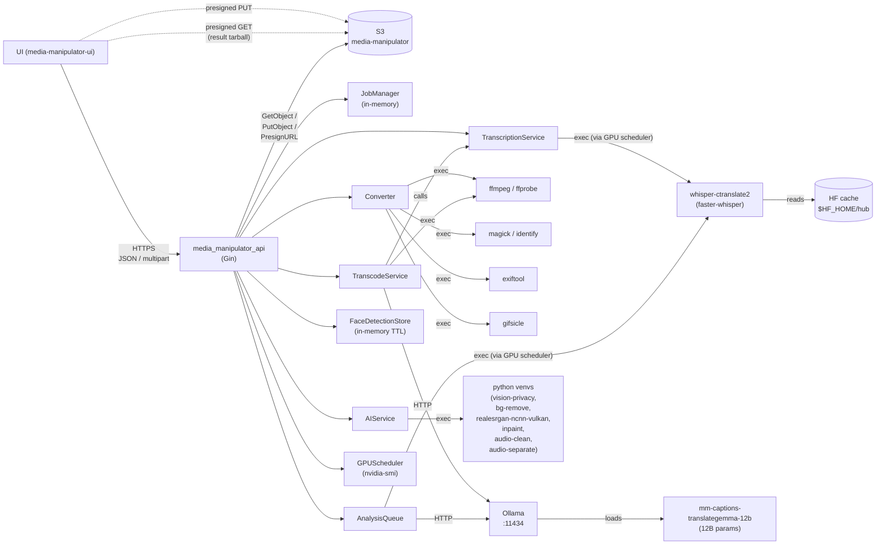
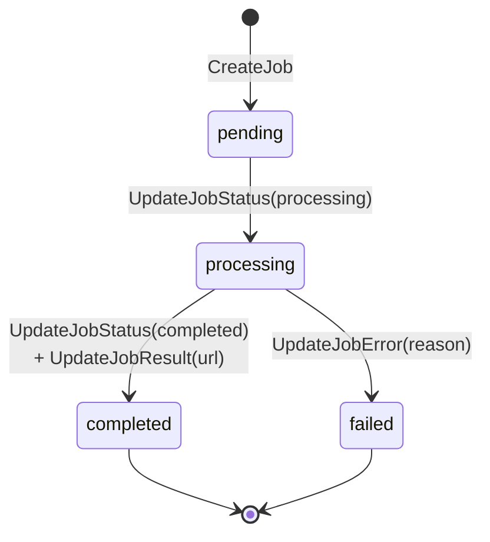
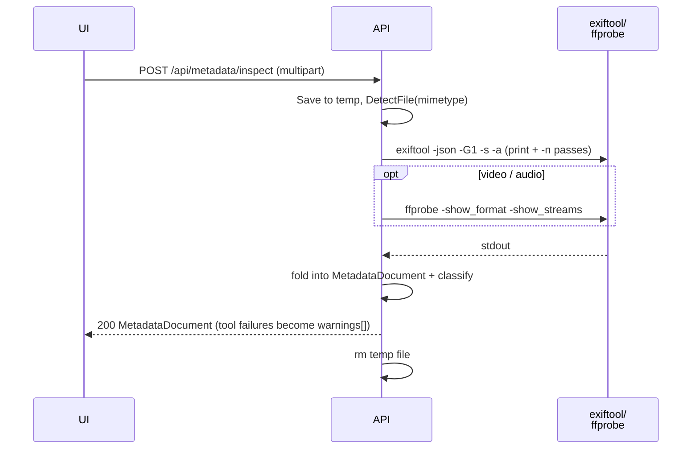
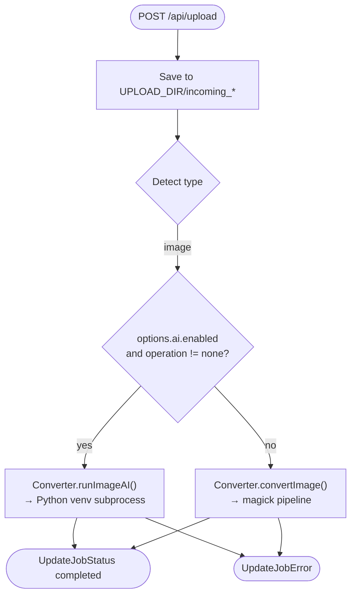
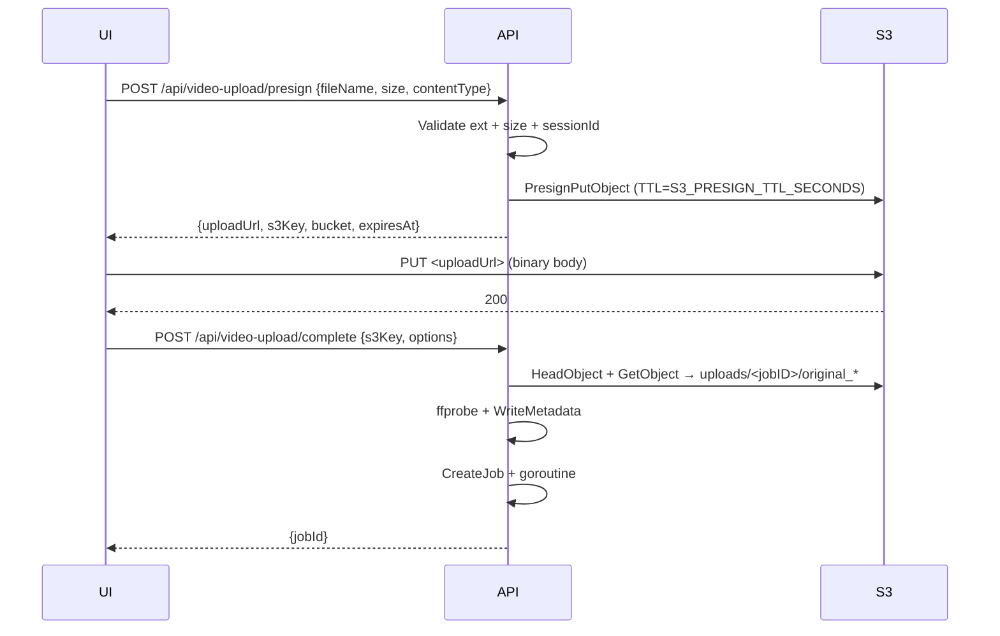
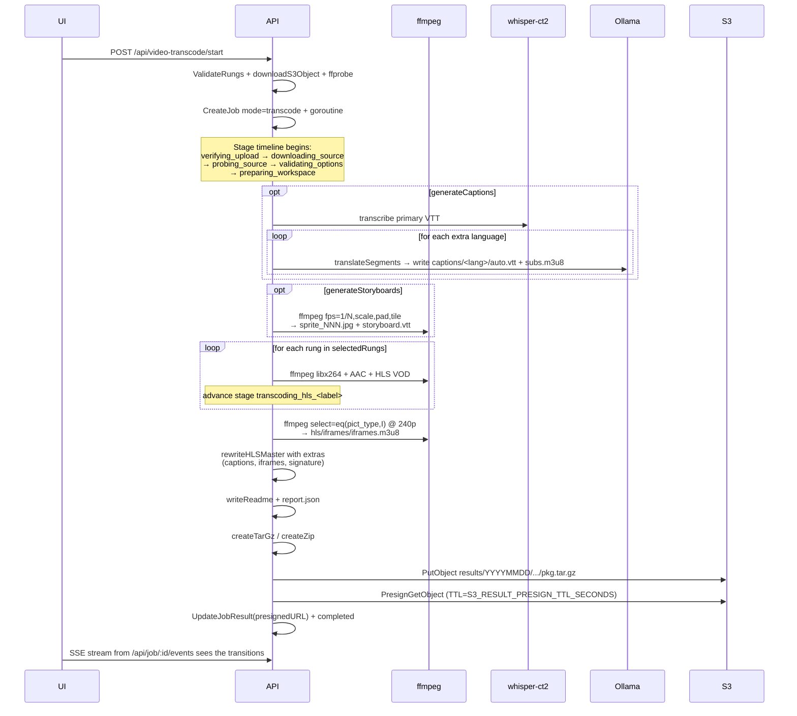
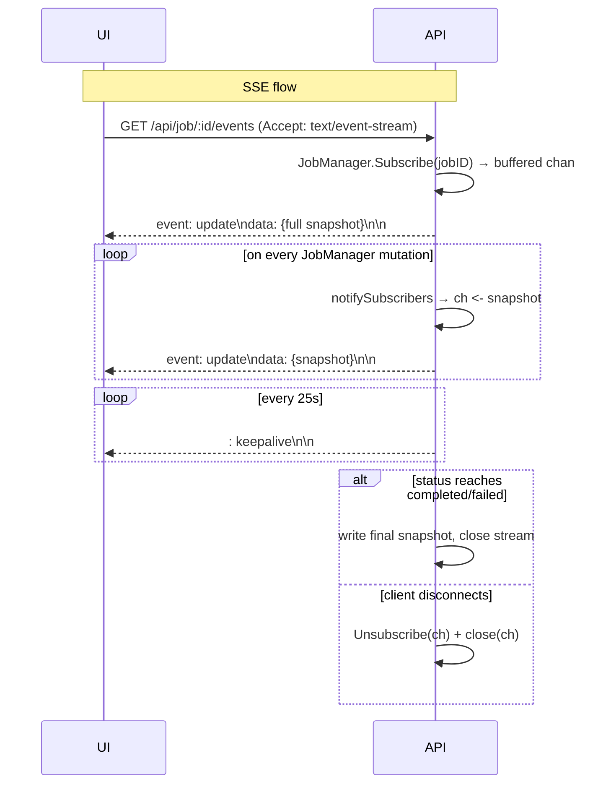
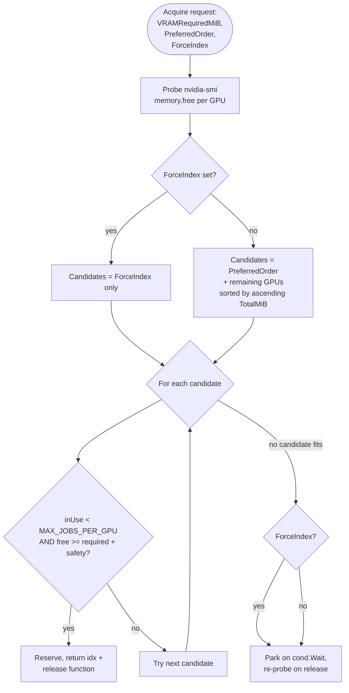

# Media Manipulator API — Runbook

Operator and on-call reference for the `media_manipulator_api` Go service.
Optimized for "something broke, what do I check?" — happy paths are described
briefly so you can compare against them, but the meat is failure modes and
debug commands.

> **Owner:** CreaTV Ltd. — single-host deployment on a Linux server with two
> NVIDIA GPUs (RTX 5060 Ti at index 0, RTX 5080 at index 1) and a local
> Ollama install. Repo:
> `Website/Frontend/media_manipulator/media_manipulator_api/`.

---

## Table of contents

1. [Service overview](#1-service-overview)
2. [Architecture diagram](#2-architecture-diagram)
3. [Quick smoke tests](#3-quick-smoke-tests)
4. [Environment variables](#4-environment-variables)
5. [HTTP API surface](#5-http-api-surface)
6. [Job lifecycle](#6-job-lifecycle)
7. [Feature playbooks](#7-feature-playbooks)
   - [7.1 Metadata inspect](#71-metadata-inspect)
   - [7.2 Image conversion (+ AI ops)](#72-image-conversion--ai-ops)
   - [7.3 Face detection preview](#73-face-detection-preview)
   - [7.4 Audio conversion (+ AI ops)](#74-audio-conversion--ai-ops)
   - [7.5 Video conversion](#75-video-conversion)
   - [7.6 Direct-to-S3 video upload](#76-direct-to-s3-video-upload)
   - [7.7 Transcription](#77-transcription)
   - [7.8 Transcode to HLS](#78-transcode-to-hls)
   - [7.9 Transcode to DASH](#79-transcode-to-dash)
   - [7.10 Job status + SSE event stream](#710-job-status--sse-event-stream)
   - [7.11 Result download](#711-result-download)
   - [7.12 Motion / vector (MM43)](#712-motion--vector-mm43)
   - [7.14 Video summary (MM74)](#714-video-summary-mm74)
8. [GPU scheduling](#8-gpu-scheduling)
9. [External dependencies](#9-external-dependencies)
10. [Common incidents and recovery](#10-common-incidents-and-recovery)
11. [Logging conventions](#11-logging-conventions)
12. [Command appendix](#12-command-appendix)
13. [DR Tasks (kanban) rollout](#13-dr-tasks-kanban-rollout)

---

## 1. Service overview

`media_manipulator_api` is a stateless-ish Go + Gin HTTP API that fronts a
set of local media-processing pipelines:

- **Conversion** (image / video / audio) via FFmpeg, ImageMagick, gifsicle.
- **AI image ops** — face privacy, background removal, super-resolution,
  text-PII redaction, object removal — via local Python venvs/scripts on a
  GPU.
- **AI audio ops** — vocal isolation/removal, noise cleanup — via Demucs and
  DeepFilter.
- **Metadata inspection** via ExifTool and FFprobe (`/api/metadata/inspect`).
- **Transcription** via `whisper-ctranslate2` (faster-whisper) on CUDA.
- **Adaptive streaming transcode** — HLS (H.264/AAC) and DASH (AV1 or VP9)
  packages with optional multilingual captions, sprite-sheet storyboards,
  and an I-frame playlist for scrubbing.
- **Caption translation** via a local Ollama model
  (`mm-captions-translategemma-12b`).

Job state is **in-memory only** (the `JobManager` map). Restarting the
process loses all in-flight jobs. Source uploads land on S3; transcode
results are uploaded back to S3 under a separate `results/` prefix and
returned to the client as presigned GET URLs.

The API speaks JSON over HTTPS, with one SSE endpoint at
`GET /api/job/:jobId/events` for live progress.

It also writes to **two separate observability stores, which must not be
confused**. `mm_*` in the `media_manipulator` database (`internal/telemetry`) is
operational truth: abuse investigation, audit, billing-grade. Separately,
`internal/analyticsemit` sends a handful of **server-truth product-analytics**
events to `media_manipulator_analytics` on port 59998 — non-authoritative, lossy by
design, and off unless `ANALYTICS_SERVER_KEY` is set. See §4.11.

---

## 2. Architecture diagram



**Process model:** single Go binary, single Gin server, multiple goroutines.
Long-running jobs run in their own goroutines fired off from the relevant
handler.

**State boundaries:**
- *In-memory*: `JobManager`, `FaceDetectionStore`, the `GPUScheduler`'s
  reservation map, the SSE subscribers map.
- *Filesystem*: `UPLOAD_DIR`, `OUTPUT_DIR`, `TEMP_DIR` (per-job
  subdirectories under each).
- *S3*: source uploads under `videos/YYYYMMDD/<sessionID>/<uuid>.<ext>`;
  transcode results under `results/YYYYMMDD/<sessionID>/<jobID>/<pkg>.tar.gz`
  (or `.zip`).
- *External services*: Ollama on localhost, S3 in us-west-2.

---

## 3. Quick smoke tests

After a deploy / restart, run these in order. They each take ~1 s.

```bash
# Process is up
curl -sS http://localhost:59997/healthz | jq .
# expect: {"status":"healthy","service":"media_manipulator_api"}

# API namespace health
curl -sS http://localhost:59997/api/health | jq .

# Transcode capabilities (confirms ffmpeg/ffprobe/encoders/Ollama reachability)
curl -sS http://localhost:59997/api/video-transcode/capabilities | jq .
```

Then watch the API log for any of these one-time-at-startup lines (search by
prefix):

| Prefix | What it tells you |
| --- | --- |
| `media-manipulator-api listening on :…` | server bound to its port |
| `gpu-scheduler: enabled with N GPUs [...]` | nvidia-smi reachable, GPU inventory |
| `gpu-scheduler: disabled — nvidia-smi unavailable …` | CPU-only mode, GPU pre-flight is a no-op |
| `whisper-ct2: model cache HF_HOME="…"` | first time whisper is invoked; cache wired |
| `whisper-ct2: WARNING — neither HF_HOME nor …` | cache wiring is broken, whisper will fail |
| `whisper-ct2: GPU auto-selected …` *(legacy — should no longer appear in current build)* | obsolete; if you see it your binary is stale |

---

## 4. Environment variables

All vars below are read at process start (via `internal/config/config.go`)
or lazily on first use (the AI/whisper/Ollama paths). Restart the process
after changing them.

### 4.1 Server / runtime

| Var | Default | Effect | Read by |
| --- | --- | --- | --- |
| `UPLOAD_DIR` | `uploads` | Where multipart uploads land before processing. | `config.go` |
| `OUTPUT_DIR` | `outputs` | Where per-job output artifacts live. | `config.go` |
| `TEMP_DIR` | `temp` | Scratch directory for short-lived files (probes, etc). | `config.go` |
| `MAX_FILE_SIZE_BYTES` | `1073741824` (1 GiB) | Hard cap on multipart uploads to `/api/upload`. | `config.go` |
| `MAX_VIDEO_UPLOAD_SIZE_BYTES` | matches `MAX_FILE_SIZE_BYTES` | Hard cap on direct-to-S3 video uploads. Independent so you can let videos be bigger. | `config.go` |
| `COMMAND_TIMEOUT_SECONDS` | `21600` (6 h) | Per-command timeout passed to FFmpeg/ImageMagick/etc. via `context.WithTimeout`. | `config.go` |
| `ANALYSIS_WORKERS` | `1` | Concurrent goroutines draining the analysis (Ollama) queue. | `config.go` |
| `AI_ENABLED` | `true` | Master switch — when `false`, the `AIService` is not built and AI ops fail with "AI service is not enabled". | `config.go` |
| `PROD` | `false` | Legacy flag that used to pin whisper to GPU 0. Now mostly inert; the GPU scheduler is the source of truth. | `transcribe.go` |

### 4.2 S3

| Var | Default | Effect |
| --- | --- | --- |
| `AWS_REGION` | `us-west-2` | Region for the S3 client. |
| `AWS_ACCESS_KEY_ID` / `AWS_SECRET_ACCESS_KEY` / `AWS_SESSION_TOKEN` | (env-only) | Standard AWS SDK credential chain. Prefer IAM role on EC2; env vars only for local dev. |
| `AWS_S3_ENDPOINT` | `""` | If set, overrides the S3 endpoint URL (used for tests/MinIO). |
| `S3_BUCKET` | `media-manipulator` | Bucket for both uploads and results. |
| `S3_PRESIGN_TTL_SECONDS` | `900` (15 min) | Lifetime of the presigned PUT URL handed back from `/video-upload/presign`. |
| `S3_RESULT_PRESIGN_TTL_SECONDS` | `1800` (30 min) | Lifetime of the presigned GET URL handed back when a transcode finishes. |
| `S3_RESULT_PREFIX` | `results` | Key prefix for transcode result tarballs. |

#### 4.2.1 Retention sweeper and the S3 lifecycle backstop (MM23)

**What deletes what.** Since MM23 the cleanup worker (same ticker, `CLEANUP_ENABLED`, `CLEANUP_INTERVAL_SECONDS`, default 15 min) does four things per tick, in this order:

1. **Ledger sweeper** (primary). Deletes whatever `mm_retained_objects` says has expired (`expires_at < now() AND deleted_at IS NULL`, oldest first, `FOR UPDATE SKIP LOCKED`): job `uploads/<id>` and `outputs/<id>` directories, S3 objects plus their proxy / sprite / peaks derivatives (`DeleteObjects`, at most 1,000 keys per call), Darkroom assets and projects (database rows first, S3 keys after), `job_row` anonymization (keeps counts and timings, nulls the result key / file name / file-name-like options and the media-asset hashes) and `metadata_report` rows. It never acts without a ledger row and refuses any disk locator that is not a single path segment under `UPLOAD_DIR` / `OUTPUT_DIR`, and any S3 key outside the `videos/`, `S3_RESULT_PREFIX` (`results/`) and `CONTENT_STUDIO_S3_PREFIX` (`studio/`) prefixes.
2. **Orphan walker** (safety net). The old mtime walker, now only for top-level entries with **no live ledger row**, at the global `UPLOAD_RETENTION_SECONDS` / `OUTPUT_RETENTION_SECONDS` (24 h) and `TEMP_RETENTION_SECONDS` (1 h). Entries the ledger tracks are never touched by it, whatever their age. If the ledger lookup fails the root is skipped for that tick. The `.mm-retention` marker is **no longer read**; a directory that still carries one is left alone for 30 days (the longest window old builds wrote), then treated as an ordinary orphan. Remove that guard (`legacyMarkerFile` in `internal/cleanup/worker.go`) once 31 days have passed.
3. **`JobManager.CleanupOldJobs`** (`RETENTION_JOB_MAP_MAX_AGE_HOURS`, default 24) trims finished jobs from the in-memory map. Account history no longer depends on that map: it reads `mm_conversion_jobs` plus the ledger, so it survives restarts.
4. **Postgres purges**, at most once an hour, 5,000 rows per statement: `mm_usage_counters` older than 400 days; `mm_safety_incidents` with `retention_until < now()` and `legal_hold = false`; raw IPs (`ip`, `cf_connecting_ip`, `x_forwarded_for`) set to NULL on `mm_api_requests` and `ip` on `mm_rate_limit_events` older than 90 days; `mm_cleanup_runs` older than 180 days (their path rows cascade); ledger rows that were stamped `deleted_at` more than 30 days ago.

**Metadata reports (ADR-0010; default changed 2026-10-24: delete with the file).** The default is now to delete a job's `metadata.json` / `metadata.result.json` together with its files: `mm_user_settings.delete_metadata_reports` defaults to `true` (migration `20261024003_default_delete_metadata_reports`) and a signed-in user with no settings row is treated the same. Only an owner who explicitly set `delete_metadata_reports` to `false` ("keep") keeps reports: sweeping their `output_dir` removes everything **except** the metadata documents, after first writing a parked `metadata_report` ledger row (`keep_with_account = true`, `expires_at = 9999-12-31`), and the account history "Metadata" button keeps working after the media is gone. The migration also switches existing rows that were never edited (`updated_at = created_at`, i.e. their `false` was the old automatic default, not a choice); rows a user edited keep their value, so an explicit "keep" is never overridden. The hourly purge pass un-parks parked rows of owners with `delete_metadata_reports = true` **or no settings row**; the next sweep deletes the documents. Guests keep nothing.

**Knobs** (all in `internal/config/config.go`):

| Var | Default | Effect |
| --- | --- | --- |
| `RETENTION_SWEEP_DRY_RUN` | `true` | **Safety switch.** While true the sweeper, the orphan walker and the purges only count and log what they *would* delete (`mm_retention_would_delete_total{kind}`, `mm_cleanup_runs.properties`), and nothing is deleted or changed. Set `false` to enforce. `CLEANUP_DRY_RUN=true` (older flag) also forces dry run. |
| `RETENTION_SWEEP_BATCH` | `200` | Ledger rows claimed per batch. |
| `RETENTION_SWEEP_BUDGET_SECONDS` | `300` | Per-tick time budget; a bigger backlog continues next tick (`properties.truncated`). |
| `RETENTION_MAX_ATTEMPTS` | `10` | After this many failed deletes a row is kept, never retried, logged at error and counted in `mm_retention_gave_up_total{kind}`. Backoff is 5 min x 2^attempts, capped at 6 h. A missing file / `NoSuchKey` counts as success. |
| `RETENTION_JOB_MAP_MAX_AGE_HOURS` | `24` | In-memory job map trim age. |

**Reading the audit.** One `mm_cleanup_runs` row per tick. `properties` is JSON: `dryRun`, `kinds.<kind>.{deleted,wouldDelete,errors,deferred,gaveUp,bytes}`, `backlogDue`, `gaveUp`, `truncated`, `purge.<rule>`, `orphanDirs`, `orphanFiles`. `mm_cleanup_deleted_paths` lists up to `CLEANUP_AUDIT_MAX_PATHS_PER_RUN` entries (`kind/locator`; dry-run rows carry `error_message = 'dry_run'`).

```sql
-- last 10 ticks, newest first
SELECT started_at, status, deleted_dirs, deleted_files, deleted_bytes, error_message,
       properties->>'dryRun' AS dry, properties->'kinds' AS kinds, properties->'purge' AS purge
FROM mm_cleanup_runs ORDER BY started_at DESC LIMIT 10;

-- rows the sweeper gave up on (need a human)
SELECT id, kind, locator, attempts, delete_error, expires_at FROM mm_retained_objects
WHERE deleted_at IS NULL AND expires_at < now() AND attempts >= 10;
```

Metrics: `mm_retention_swept_total{kind}`, `mm_retention_would_delete_total{kind}`, `mm_retention_sweep_errors_total{kind}`, `mm_retention_gave_up_total{kind}`, `mm_retention_backlog{state="due"|"gave_up"}`. The server analytics event `server_retention_swept {kind, countBucket}` is emitted once per kind per tick that deleted something (never in dry run); it is dropped today for lack of a visitor id, like the billing events.

**Forcing a sweep.** There is no endpoint for the ticker (MM24's user-delete routes run an inline sweep of just the caller's rows, 4.2.2). To run one now: `sudo systemctl restart media-manipulator-api` (the worker runs a tick immediately at boot), or lower `CLEANUP_INTERVAL_SECONDS`. To make one row due: `UPDATE mm_retained_objects SET expires_at = now() - interval '1 minute', next_attempt_at = NULL WHERE id = '...';` then wait for a tick. To retry a given-up row: `UPDATE mm_retained_objects SET attempts = 0, next_attempt_at = NULL WHERE id = '...';`.

**First deploy / rollout (read this before enabling).**

1. Run migration `20261023005_add_retention_sweeper` (adds `next_attempt_at`, `keep_with_account` and indexes; deletes nothing). The `mm_api_requests` index builds under a write lock: pick a quiet minute, or pre-create it with `CREATE INDEX CONCURRENTLY IF NOT EXISTS mm_api_requests_ip_scrub_idx ON mm_api_requests(created_at) WHERE ip IS NOT NULL OR cf_connecting_ip IS NOT NULL OR x_forwarded_for IS NOT NULL;`.
2. Deploy with the default `RETENTION_SWEEP_DRY_RUN=true`. Pre-MM22 data has no ledger rows, so the ledger sweeper has little to do at first; the orphan walker's dry-run output shows exactly which pre-existing directories it would remove at 24 h.
3. After about a day, read `mm_cleanup_runs` (query above). Check `kinds`, `orphanDirs` and the `mm_cleanup_deleted_paths` sample against what you expect. If anything looks wrong, stop here.
4. Enforce: set `RETENTION_SWEEP_DRY_RUN=false` **and** `CLEANUP_DRY_RUN=false`, restart. Watch `mm_retention_sweep_errors_total` and `mm_retention_gave_up_total` for the first hour.
5. Rollback is flipping `RETENTION_SWEEP_DRY_RUN=true` and restarting. Deleted data is not recoverable (there are no backups of media).

**S3 lifecycle backstop (a human step, not done by code).** The sweeper only deletes objects that have a ledger row. Anything uploaded before MM22, and anything whose registration failed (`mm_retention_register_failed_total`), has none, so S3 itself must expire it. Rule: prefixes `videos/`, `results/`, `studio/` (the prefix values of `S3_RESULT_PREFIX` and `CONTENT_STUDIO_S3_PREFIX`; adjust if you changed them) expire current versions 2 years + 7 days = **737 days** after creation, which is longer than the maximum 2-year user window plus a week of slack, so it never beats the sweeper for a ledgered object. Also abort incomplete multipart uploads after 7 days. Do not apply it to the whole bucket: `double-raven/`, `documents/`, `feedback/` and `chatlab/` belong to the Double Raven portal.

Console steps (S3 console, us-west-2):

1. S3 > Buckets > `media-manipulator` (your `S3_BUCKET`) > **Management** > **Lifecycle rules** > **Create lifecycle rule**.
2. Rule name `mm-retention-backstop-videos`. Scope: **Limit the scope of this rule using one or more filters**, prefix `videos/`. Tick the acknowledgement.
3. Lifecycle rule actions: tick **Expire current versions of objects** and **Delete incomplete multipart uploads**. (If the bucket is versioned also tick **Permanently delete noncurrent versions of objects** with 7 days.)
4. Expire current versions: **737** days after object creation. Incomplete multipart uploads: **7** days.
5. **Create rule**. Repeat for `results/` (`mm-retention-backstop-results`) and `studio/` (`mm-retention-backstop-studio`). If a rule already exists for a prefix, edit it instead.

Equivalent JSON (`aws s3api put-bucket-lifecycle-configuration --bucket "$S3_BUCKET" --lifecycle-configuration file://lifecycle.json`; this REPLACES the bucket's whole lifecycle configuration, so merge with any existing rules first: `aws s3api get-bucket-lifecycle-configuration --bucket "$S3_BUCKET"`):

```json
{
  "Rules": [
    {
      "ID": "mm-retention-backstop-videos",
      "Status": "Enabled",
      "Filter": { "Prefix": "videos/" },
      "Expiration": { "Days": 737 },
      "AbortIncompleteMultipartUpload": { "DaysAfterInitiation": 7 }
    },
    {
      "ID": "mm-retention-backstop-results",
      "Status": "Enabled",
      "Filter": { "Prefix": "results/" },
      "Expiration": { "Days": 737 },
      "AbortIncompleteMultipartUpload": { "DaysAfterInitiation": 7 }
    },
    {
      "ID": "mm-retention-backstop-studio",
      "Status": "Enabled",
      "Filter": { "Prefix": "studio/" },
      "Expiration": { "Days": 737 },
      "AbortIncompleteMultipartUpload": { "DaysAfterInitiation": 7 }
    }
  ]
}
```

Note: the earliest this rule deletes anything is 737 days after the oldest object, so it cannot hurt a recent upload; and because a user's maximum window is 2 years, it can only ever remove objects the ledger has already forgotten.

#### 4.2.2 User deletion, account deletion and export (MM24)

**Deploy first:** run migration `20261023006_add_deletion_and_export` (adds `mm_retained_objects.kept_longer` and the `mm_account_deletions` table; deletes nothing). Until it runs, "keep longer", account deletion's tombstone and the sign-in tombstone check fail (the sign-in check fails closed: no session claim, logged as `tombstone lookup failed`).

**Inline sweep.** `DELETE /api/jobs/:jobId`, `DELETE /api/studio/projects/:id`, `POST /api/account/data/delete-all` and `DELETE /api/account` mark the matching ledger rows due and run the same per-kind deleters the ticker uses, synchronously for at most 30 s (`pending: N` in the response is what is left; the ticker finishes it). User deletes ignore `RETENTION_SWEEP_DRY_RUN` and `CLEANUP_ENABLED`: they act only on rows the caller just asked to delete. They also delete parked metadata reports and the whole output directory (no "keep metadata" exception). Stuck row: same SQL as 4.2.1.

**Account deletion** (`DELETE /api/account`, body `{"confirm":"DELETE MY ACCOUNT"}`, Firebase `auth_time` < 5 min else `401 reauth_required`). Order: Stripe cancel, sweep (halts with files pending: it never orphans files), projects, settings + grants, job anonymize, analytics DSR, tombstone, `mm_users` row, Firebase user. A halted run returns 502 with `retryable: true` and per-step status; the same signed-in user calls again and it resumes (an already-removed `mm_users` row skips the data steps). Metric: `mm_account_deleted_total{result="completed|incomplete|files_pending"}`; `mm_data_deleted_total{scope="item|project|all"}`.

**Analytics DSR dependency.** Step "analytics" does `POST $ANALYTICS_INGEST_URL/v1/dsr/delete` with the caller's own Firebase ID token (person scope; the analytics service verifies it against the same Firebase project; 5 req/min/IP there). A failure is reported as `analytics: "failed"` in the response and does NOT block deletion; finish it by hand with the analytics admin DSR tool. `ANALYTICS_INGEST_URL` empty reports `not_configured`. Stripe: with billing not configured the step reports `skipped`.

**Tombstone.** `mm_account_deletions(firebase_uid_hash, deleted_at)` holds sha256(salt:uid) for 30 days (purge rule `account_deletions`, hourly with the other purges). A sign-in with that uid inside 30 days still gets its account, but `/account/sync` claims no prior session rows.

**Export** (`GET /api/account/data/export`): streamed zip (history, projects, files, account, metadata reports, README), 3 per hour per user (Redis when `RATE_LIMIT_ENABLED`, plus an in-process floor).

**Download after restart.** `GET /api/download/:jobId` and `/api/result/:jobId` fall back to Postgres + the ledger when the in-memory job is gone, with the MM05 ownership rules; a job with no live ledger row is 404 even if a file lingers.

### 4.3 Whisper / transcription

| Var | Default | Effect |
| --- | --- | --- |
| `WHISPER_CT2_BIN` | `/opt/creatv/whisper-ct2/bin/whisper-ctranslate2` | Path to the binary. If the path doesn't exist, the resolver falls back to the default constant, then `$PATH`. |
| `WHISPER_CT2_MODEL` | `medium` (transcribe.go) / `large-v3` (analysis_queue.go) | Whisper model name to load. |
| `WHISPER_CT2_DEVICE` | `cuda` | `cuda` or `cpu`. |
| `WHISPER_CT2_DEVICE_INDEX` | unset | **Preference list** (comma-separated allowed, e.g. `"0"` or `"0,1"`). Scheduler falls through on capacity. |
| `WHISPER_CT2_FORCE_DEVICE_INDEX` | unset | Hard pin — waits for the specific GPU even if it's full, never falls back. |
| `WHISPER_DISABLE_GPU_AUTOSELECT` | `false` | Skips nvidia-smi probing for device choice (legacy escape). |
| `WHISPER_CT2_COMPUTE_TYPE` | `float16` | `float16`, `float32`, `int8`, `int8_float16`. Drives VRAM estimate too. |
| `WHISPER_CT2_VAD_FILTER` | `true` | Enable voice-activity-detection trimming. |
| `WHISPER_CT2_BATCHED` | `false` (transcribe.go) / `true` (analysis_queue.go) | Enable batched inference. |
| `WHISPER_CT2_BATCH_SIZE` | `8` | Batch size when batched mode is on. |
| `WHISPER_CT2_LANGUAGE` | unset (auto-detect) | BCP-47 language hint. |
| `WHISPER_CT2_OUTPUT_DIR` | `/tmp/ct2_out` | Scratch dir for whisper's JSON output. |
| `WHISPER_GPU_CONCURRENCY` | `1` | Process-wide semaphore on concurrent whisper invocations. Bump to your GPU count for true multi-GPU parallel. |
| `WHISPER_HF_CACHE_DIR` | unset → falls back to `HF_HOME` | Explicit `HF_HOME` override applied to the subprocess. Use this when systemd doesn't carry your shell's `HF_HOME`. |
| `HF_HOME` | unset | HuggingFace cache root. Models live under `$HF_HOME/hub/`. |
| `WHISPER_ALLOW_HF_NETWORK` | `false` | Default is offline (`HF_HUB_OFFLINE=1`, `TRANSFORMERS_OFFLINE=1`). Set to `true` only when downloading a new model. |
| `GPU_SCHED_MAX_JOBS_PER_GPU` | `1` | Per-GPU concurrent job cap. |
| `GPU_SCHED_SAFETY_MARGIN_MIB` | `512` | Required-free padding on top of the VRAM estimate. |

### 4.4 Ollama (analysis + caption translation)

| Var | Default | Effect |
| --- | --- | --- |
| `OLLAMA_URL` | `http://localhost:11434` | Base URL of the Ollama HTTP API. |
| `OLLAMA_TIMEOUT_SECONDS` | `300` | Per-request timeout for chat completions. |
| `OLLAMA_VLM_MODEL` | `qwen3-vl:8b-instruct-q8_0` | Vision-language model used by the transcript analyzer (`analysis_queue.go`). |
| `OLLAMA_TEXT_MODEL` | falls back to `OLLAMA_VLM_MODEL` | Text-only model for transcript summary/safety review. |
| `OLLAMA_CAPTIONS_MODEL` | `mm-captions-translategemma-12b` | Translation model invoked for additional caption tracks. |
| `OLLAMA_VLM_FRAME_INTERVAL_SECONDS` | `10` | When analyzing silent video, sample one frame every N seconds. |
| `OLLAMA_VLM_MAX_WIDTH` | `768` | Max width of frames sent to the VLM. |
| `OLLAMA_VLM_MAX_FRAMES` | `24` | Max frames per analysis batch. |
| `OLLAMA_VLM_BATCH_SIZE` | `4` | Inner batch size when calling the VLM. |
| `SUMMARY_ENABLED` | `false` | MM74 video summary master switch. Off: `/api/summarize/capabilities` says `enabled:false` and `POST /api/summarize/start` answers 503 `summary_unavailable` (refunded). Section 7.14. |
| `OLLAMA_SUMMARY_MODEL` | `qwen3.5:9b-q8_0` | MM74 synthesis model (the text model already on the `OLLAMA_URL` daemon). The frame pass always uses `OLLAMA_VLM_MODEL`. |
| `OLLAMA_SUMMARY_DEEP_MODEL` | empty (deep off) | MM74 `deep` synthesis model for Pro, e.g. `qwen3.8:27b`. Needs `OLLAMA_SUMMARY_DEEP_URL` too. **Leave unset until Mitch's benchmark passes** (section 7.14). |
| `OLLAMA_SUMMARY_DEEP_URL` | empty (deep off) | MM74 daemon serving the deep model: the third, unpinned daemon `http://127.0.0.1:11436` (`ollama-mm-summary.service`). |
| `OLLAMA_SUMMARY_MAX_INPUT_TOKENS` | `12000` | MM74 synthesis input budget (estimated). Over it, the least informative frame notes are dropped first, then the transcript is condensed; each adds a caveat to the summary. `num_ctx` is this + 4096. |
| `SUMMARY_WORKERS` | `1` | MM74 summary queue workers (serial, like `ANALYSIS_WORKERS`): two summaries never load models at once. Keep 1 on the two-card box. |
| `SUMMARY_STAGE_TIMEOUT_SECONDS` | `1800` | MM74 bound on each heavy stage (audio, frames, vision, synthesis); a timeout fails the job and refunds its `ai_ops`. The whole job is bounded by `COMMAND_TIMEOUT_SECONDS`. |

### 4.5 AI image / audio toolchain

| Var | Default | Effect |
| --- | --- | --- |
| `AI_ROOT_DIR` | `/opt/media-manipulator-ai` | Root of every Python venv / script / model directory below. |
| `AI_CUDA_GPU` | `1` | CUDA device index passed to the Python AI scripts. Should be the RTX 5080. |
| `AI_VULKAN_GPU` | `1` | GPU index for Vulkan-based realesrgan-ncnn. |
| `AI_DEEPFILTER_BIN` | `${AI_ROOT_DIR}/venvs/audio-clean/bin/deepFilter` | DeepFilterNet (audio denoise). |
| `AI_DEMUCS_BIN` | `${AI_ROOT_DIR}/venvs/audio-separate/bin/demucs` | Demucs (vocals isolate/remove). |
| `AI_VISION_PYTHON` | `${AI_ROOT_DIR}/venvs/vision-privacy/bin/python` | Python that runs face_privacy and text-PII scripts. |
| `AI_FACE_PRIVACY_SCRIPT` | `${AI_ROOT_DIR}/scripts/face_privacy.py` | Path to the runtime script (a reference copy lives at `scripts/server/face_privacy.py` in the repo). |
| `AI_TEXT_REDACT_SCRIPT` | `${AI_ROOT_DIR}/scripts/redact_text_pii.py` | OCR-based text redaction script. |
| `AI_REMBG_BIN` | `${AI_ROOT_DIR}/venvs/bg-remove/bin/rembg` | rembg CLI for background removal. |
| `AI_REMBG_ENV_SCRIPT` | `${AI_ROOT_DIR}/env/onnxruntime-cuda-bg-remove.sh` | Shell script that exports CUDA paths for rembg. |
| `AI_REMBG_MODEL_DIR` | `${AI_ROOT_DIR}/models/rembg` | rembg model cache. |
| `AI_REALESRGAN_BIN` | `${AI_ROOT_DIR}/bin/realesrgan-ncnn-vulkan/realesrgan-ncnn-vulkan` | RealESRGAN Vulkan binary. |
| `AI_VULKAN_ENV_SCRIPT` | `${AI_ROOT_DIR}/env/vulkan-nvidia.sh` | Shell script that exports Vulkan paths. |
| `AI_LAMA_PYTHON` | `${AI_ROOT_DIR}/venvs/inpaint/bin/python` | Python for simple_lama_inpainting (object removal). |
| `AI_REMOVE_OBJECT_SCRIPT` | `${AI_ROOT_DIR}/scripts/remove_object_lama.py` | The runtime path for the object-removal script. |

> **Note on the AI scripts:** the reference copies in
> `scripts/server/*.py` are checked into the repo so updates are reviewable.
> The runtime path on the server is set by the env vars above and is
> conventionally `/opt/media-manipulator-ai/scripts/*.py`. Deploy with
> `sudo cp scripts/server/<script>.py /opt/media-manipulator-ai/scripts/`.

> **AI Video Restoration install:** the six-model restoration pipeline
> (Real-ESRGAN, SwinIR, HAT, BasicVSR++, RVRT, VRT) needs two extra venvs
> (`restore-sr`, `restore-vsr-mm`), five repo clones, model weights, and the
> `restore_frames.py` / `restore_video.py` scripts deployed. The full
> operator procedure — including the Blackwell (sm_120) torch cu128 and
> mmcv-from-source requirements — lives in
> [`docs/INSTALL_VIDEO_RESTORATION.md`](docs/INSTALL_VIDEO_RESTORATION.md).

### 4.6 AI Video Restoration

| Var | Default | Effect |
| --- | --- | --- |
| `RESTORE_ENABLED` | `true` | Master switch for `/api/video-restore/*` (off → 503 on start, `enabled:false` in capabilities). |
| `RESTORE_BASICVSRPP_ENABLED` | `true` | Independent flag for BasicVSR++ (its mmcv/mmagic venv is the most fragile install). |
| `RESTORE_MAX_CLIP_SECONDS` | `15` | Hard cap on the selected snippet window. |
| `RESTORE_RECOMMENDED_CLIP_SECONDS` | `10` | Soft cap surfaced in capabilities; the UI warns above it. |
| `RESTORE_MAX_FRAMES` | `450` | Frame cap — enforced fps-aware at probe time and re-checked after extraction. |
| `RESTORE_MAX_SOURCE_WIDTH` / `_HEIGHT` | `1920` / `1080` | Source resolution caps (restoration targets low-res footage). |
| `RESTORE_MAX_CONCURRENT_JOBS` | `1` | Process-wide restore job semaphore; queued jobs stay `pending` with stage `queued`. |
| `RESTORE_MODEL_TIMEOUT_SECONDS` | `4500` | Per-model subprocess timeout. |
| `RESTORE_RESULT_PRESIGN_TTL_SECONDS` | `21600` | Result tarball download-link TTL (6h — the archives are huge). |
| `RESTORE_RATE_LIMIT_PER_SESSION_PER_HOUR` / `_PER_IP_PER_HOUR` | `2` / `4` | Dedicated rate bucket for `/api/video-restore/start`. |
| `AI_RESTORE_CUDA_GPU` | `0` | CUDA index of the 16GB RTX 5080 (PyTorch models pin to it). |
| `AI_RESTORE_VULKAN_GPU` | `1` | Vulkan index for realesrgan-ncnn. |
| `AI_RESTORE_PYTHON` | `${AI_ROOT_DIR}/venvs/restore-sr/bin/python` | venv python for SwinIR/HAT/RVRT/VRT. |
| `AI_RESTORE_MM_PYTHON` | `${AI_ROOT_DIR}/venvs/restore-vsr-mm/bin/python` | venv python for BasicVSR++ (mmcv/mmagic). |
| `AI_RESTORE_FRAMES_SCRIPT` | `${AI_ROOT_DIR}/scripts/restore_frames.py` | Per-frame SR wrapper (repo source: `scripts/server/restore_frames.py`). |
| `AI_RESTORE_VIDEO_SCRIPT` | `${AI_ROOT_DIR}/scripts/restore_video.py` | Video-restoration wrapper (repo source: `scripts/server/restore_video.py`). |
| `AI_RESTORE_MODELS_DIR` | `${AI_ROOT_DIR}/models/restore` | Weight files, one subdir per model. |
| `AI_RESTORE_REPOS_DIR` | `${AI_ROOT_DIR}/repos` | SwinIR/HAT/RVRT/VRT/mmagic clones. |
| `RESTORE_EST_SPF_<MODEL>` | `0.8/3.5/5.0/1.0/3.0/7.0` | Estimated seconds-per-frame (REALESRGAN/SWINIR/HAT/BASICVSRPP/RVRT/VRT) — feeds UI estimates; tune after real runs. |
| `RESTORE_VRAM_MIB_<MODEL>` | `3000/9000/10000/11000/12000/14000` | Per-model VRAM budgets for the GPU scheduler. |
| `RESTORE_REQUIRE_FIREBASE_AUTH` | `false` | Future seam: when on, `/api/video-restore/*` requires a Firebase ID token (`Authorization: Bearer`). |
| `FIREBASE_PROJECT_ID` | _(empty)_ | Firebase project for token verification (with `GOOGLE_APPLICATION_CREDENTIALS`). |

> **AI Image Restoration install:** the still-image sibling of video
> restoration. General models (Real-ESRGAN/SwinIR/HAT) reuse the existing
> `AI_RESTORE_*` paths/venvs/scripts — **zero new installs**. Two new venvs are
> only needed for the optional stages: `face-restore` (GFPGAN/CodeFormer) and
> `preclean` (FBCNN/SCUNet/NAFNet), plus their repo clones, weights, and the
> `restore_image_faces.py` / `preclean_image.py` scripts. Operator procedures:
> [`docs/INSTALL_FACE_RESTORATION.md`](docs/INSTALL_FACE_RESTORATION.md) and
> [`docs/INSTALL_PRECLEAN_MODELS.md`](docs/INSTALL_PRECLEAN_MODELS.md). API
> contract: [`docs/IMAGE_RESTORATION.md`](docs/IMAGE_RESTORATION.md).

### 4.7 AI Image Restoration & Upscaling

Shares the Firebase-gated `restoreGroup` (so `RESTORE_REQUIRE_FIREBASE_AUTH`
gates it identically) and reuses `AI_RESTORE_*` (general-model paths, models
dir, repos dir, GPU indices). General models run via the existing
`restore_frames.py` against a one-image frames dir; pre-clean/face scripts run
in their own venvs and address the physical card via `--gpu <AI_CUDA_GPU>`.

| Var | Default | Effect |
| --- | --- | --- |
| `IMAGE_RESTORE_ENABLED` | `true` | Master switch for `/api/image-restore/*` (off → 503 on start, `enabled:false` in capabilities). |
| `IMAGE_RESTORE_CODEFORMER_ENABLED` | `false` | License gate (CodeFormer is S-Lab non-commercial). Off → capabilities reports codeformer `available:false`, reason "currently disabled". |
| `IMAGE_RESTORE_MAX_SOURCE_WIDTH` / `_HEIGHT` | `12000` / `12000` | Source resolution caps. |
| `IMAGE_RESTORE_MAX_OUTPUT_PIXELS` | `67108864` | Output pixel budget (~64MP, past 8K). Re-checked at prepare against the actual crop×scale. |
| `IMAGE_RESTORE_MAX_OUTPUTS` | `12` | Cap on total output units `p + g + f + chain·f·g`. |
| `IMAGE_RESTORE_MAX_CONCURRENT_JOBS` | `1` | Process-wide job semaphore; queued jobs stay `pending` with stage `queued`. |
| `IMAGE_RESTORE_MODEL_TIMEOUT_SECONDS` | `1800` | Per-unit subprocess timeout. |
| `IMAGE_RESTORE_RATE_LIMIT_PER_SESSION_PER_HOUR` / `_PER_IP_PER_HOUR` | `6` / `12` | Dedicated rate bucket for `/api/image-restore/start` (image jobs are far cheaper than video). |
| `AI_FACE_RESTORE_PYTHON` | `${AI_ROOT_DIR}/venvs/face-restore/bin/python` | venv python for GFPGAN/CodeFormer. |
| `AI_FACE_RESTORE_SCRIPT` | `${AI_ROOT_DIR}/scripts/restore_image_faces.py` | Face wrapper (repo source: `scripts/server/restore_image_faces.py`). |
| `AI_PRECLEAN_PYTHON` | `${AI_ROOT_DIR}/venvs/preclean/bin/python` | venv python for FBCNN/SCUNet/NAFNet. |
| `AI_PRECLEAN_SCRIPT` | `${AI_ROOT_DIR}/scripts/preclean_image.py` | Pre-clean wrapper (repo source: `scripts/server/preclean_image.py`). |
| `IMAGE_RESTORE_EST_SPM_<MODEL>` | `3/8/6/2/12/18/6/8` | Estimated seconds-per-megapixel (FBCNN/SCUNET/NAFNET/REALESRGAN/SWINIR/HAT/GFPGAN/CODEFORMER) — feeds UI estimates + stage weights. |
| `IMAGE_RESTORE_VRAM_MIB_<MODEL>` | `3000/4000/4000/—/—/—/5000/6000` | Per-model VRAM budgets for the GPU scheduler (general models reuse `RESTORE_VRAM_MIB_*`). |

Results are **not** uploaded to S3 (the archives are tens–hundreds of MB, not
multi-GB): the tarball stays in the job output dir and is served by the shared
`/api/download/:jobId`; result PNGs stay alongside it for the results/preview
endpoints until the 24h cleanup sweep. See `docs/IMAGE_RESTORATION.md`.

### 4.8 Double Raven partner portal

Private, always-Firebase-gated document API (`GET /api/dr/docs`,
`GET /api/dr/docs/:slug`) serving the `/dr` portal in `media-manipulator-ui`.
Unlike the restore seam, `/api/dr/*` has **no** pass-through mode: it fails
**closed** — nil verifier → `503`, missing/invalid token → `401`, authenticated
but not on the allowlist → `403`. The claims verifier is initialized
unconditionally at startup from `FIREBASE_PROJECT_ID` (independent of
`RESTORE_REQUIRE_FIREBASE_AUTH`) and reuses `GOOGLE_APPLICATION_CREDENTIALS`. The
document store (`dr_documents` + `dr_document_revisions`, seeded by
`init_double_raven_docs`) requires the pgx pool — no `DATABASE_URL` → `503`.

| Var | Default | Effect |
| --- | --- | --- |
| `DR_ALLOWED_EMAILS` | _(empty)_ | Comma-separated, case-insensitive allowlist of the Firebase accounts permitted into `/api/dr/*`. Empty → any verified project user passes (accounts are console-only) **and the server logs a startup warning** — set it. Your authz backstop. |
| `FIREBASE_PROJECT_ID` | _(empty)_ | Also used to init the DR claims verifier; if unset the DR group fails closed with `503`. |
| `GOOGLE_APPLICATION_CREDENTIALS` | _(empty)_ | Firebase Admin service-account JSON path (shared with the restore seam). The one true secret — never commit. |

### 4.9 DR AI Chat Test Lab (OpenRouter)

The `/dr/demos/chat-lab` chat is backed by OpenRouter, called from THIS API
(never from the Next.js layer) so the key stays on the home server. All routes
live under `/api/dr/chatlab/*` behind the same always-on DR auth as §4.8.
Runtime verification: `docs/dr-chatlab-verification.md`.

| Var | Default | Effect |
| --- | --- | --- |
| `OPENROUTER_API_KEY` | _(empty)_ | OpenRouter Bearer key. **Empty → chat-lab send/models endpoints return 503 `{"error": "AI chat is not configured"}`** (fail closed). The other true secret — never commit or log. |
| `OPENROUTER_BASE_URL` | `https://openrouter.ai/api/v1` | API root override, for testing only. |
| `DR_CHATLAB_MODEL_RULES` | `anthropic/,openai/,z-ai/glm-5.2,moonshotai/kimi-k2.6,google/gemini-3.1-pro-preview,google/gemini-3-pro-preview,google/gemini-3.1-flash-lite,google/gemini-3.5-flash,qwen/qwen3.7-plus,google/gemini-3-flash-preview,google/gemini-2.5-flash,google/gemini-2.0-flash-001,qwen/qwen3.6-plus,qwen/qwen3.6-flash,qwen/qwen3.7-max,qwen/qwen3-vl-235b-a22b-instruct` | CSV of allow rules against the live model catalog. A rule ending in `/` is a provider prefix match; anything else is an exact model-id match (Gemini/Qwen are deliberately exact ids — those providers publish dozens of unrelated models). Prefix rules exclude `:free`/`:extended`-style variants; an exact rule naming a variant admits it. Case-insensitive. Gemini `-preview` slugs drift — `docs/dr-chatlab-stats-feedback-verification.md` §2 has the check. |
| `DR_CHATLAB_TITLE_MODEL` | _(empty)_ | Optional cheap model id for auto-titling new chats (e.g. `openai/gpt-5.2-mini`). Empty disables LLM titling — titles fall back to a truncation of the first message. |
| `DR_CHATLAB_MAX_OUTPUT_TOKENS` | `8192` | `max_tokens` sent upstream per completion. |
| `DR_CHATLAB_ATTRIBUTION_URL` | `https://media-manipulator.com` | Sent as OpenRouter's `HTTP-Referer` app-attribution header. |
| `DR_CHATLAB_MEMORY_MODEL` | _(empty)_ | Cheap model id that regenerates each project's living memory (e.g. `openai/gpt-5.2-mini`). **Empty = memory disabled** — projects still work, the Memory card shows `disabled`. Runtime verification: `docs/dr-chatlab-projects-verification.md`. |
| `DR_CHATLAB_MEMORY_MAX_CHARS` | `4096` | Hard cap on the generated project memory (chars). |
| `DR_CHATLAB_TOOL_MAX_ROUNDS` | `5` | Max upstream rounds per send in the `read_asset` tool loop (exceeding → the turn ends with `Tool call limit reached`). |
| `DR_CHATLAB_ASSET_READ_CAP_BYTES` | `49152` | Per-read cap on text/code asset content returned to the model (truncated with a note beyond it). |

Usage & spend analytics (`/api/dr/chatlab/stats/*`, `/api/dr/chatlab/credits`)
and response feedback (`/api/dr/chatlab/messages/:id/feedback`) need no new
env vars — every OpenRouter call (chat/title/memory) is recorded as an
immutable `dr_chat_usage_events` row (NO FKs: the financial record survives
session/project hard-deletes), and the credit balance is a manual ledger
(`dr_chat_credit_ledger`) reconciled against the OpenRouter dashboard with
adjustment entries. Runtime verification:
`docs/dr-chatlab-stats-feedback-verification.md`.

### 4.10 DR Portal desktop app downloads

`GET /api/dr/desktop/download-url?platform=mac-arm64|mac-intel|windows` (same
always-on DR auth as §4.8) returns a **5-minute** presigned GET for the private
desktop installer in the shared bucket, with an `attachment` Content-Disposition
so the browser downloads it under the artifact's own filename. The keys default
to the `0.1.0` electron-builder artifacts and contain **literal spaces** (the SDK
presigner handles encoding) — a version bump is an env change + an S3 upload, no
deploy. Runtime verification: `docs/dr-desktop-downloads-verification.md`.

| Var | Default | Effect |
| --- | --- | --- |
| `DR_DESKTOP_MAC_ARM64_KEY` | `double-raven/desktop/mac/apple/Double Raven Portal-0.1.0-arm64.dmg` | S3 key of the Mac (Apple Silicon) `.dmg`. |
| `DR_DESKTOP_MAC_INTEL_KEY` | `double-raven/desktop/mac/intel/Double Raven Portal-0.1.0.dmg` | S3 key of the Mac (Intel) `.dmg`. |
| `DR_DESKTOP_WINDOWS_KEY` | `double-raven/desktop/windows/Double Raven Portal Setup 0.1.0.exe` | S3 key of the Windows installer `.exe`. |

### 4.11 Tiers, quotas and the operator allowlist

Every number the product promises resolves through `internal/tiers` (fed by
`TIER_*` env vars; `/pricing` renders `GET /api/tiers`). `TIER_QUOTA_ENABLED`
(default `true`) is the single kill switch for the whole tier system.

**Only delivered work counts (2026-10-28).** `RequireQuota` spends a unit
*before* the handler runs (the only place a concurrent over-spend can be
stopped) and leaves a `middleware.QuotaCharge` on the request. The unit is
given back (`Store.DecrementUsage`, floored at zero, same UTC day) in two cases:
the handler answered 4xx/5xx (oversized or over-limit source, unsupported type,
a save failure), which the middleware refunds itself after `c.Next()`; or the
job the request started later fails, which `JobManager` refunds through the
charge `recordJobCreated` attached to the job (`SetJobQuotaCharge`). A refund is
idempotent and the over-limit 429 is never refunded. The `X-MM-Quota-*` headers
on a refused response were written before the refund and overstate usage by
one; the UI discards them on non-2xx and re-reads `/api/account/usage`.

The **operator** tier is the site's own people. It is not a plan: it does not
appear in `/api/tiers`, cannot be stored on `mm_users` (the CHECK forbids it),
and `cmd/grant-tier` cannot grant it. It is re-derived on **every request** from
the Firebase ID token the Admin SDK verified, and only when that token carries
`email_verified=true` for an address on the list — so no header, query string,
client flag or database row can produce it, and a stranger who registers one
of the listed addresses with a password (unverified) gets the free tier.

An operator gets Pro's capabilities (the top public rung, MM39; Pro equals
Premium on every cap except the daily allowances) with every allowance removed: `ops`,
`ai_ops` and `export` are uncounted (nothing is written to `mm_usage_counters`),
the saved-project cap is unlimited, the per-route hourly abuse buckets
(`RATE_LIMIT_*_PER_HOUR`, `*_RATE_LIMIT_PER_*_PER_HOUR`) are skipped, and the
upload-size / source-duration caps are the deployment ceilings
(`MAX_FILE_SIZE_BYTES`, `MAX_VIDEO_DURATION_SECONDS`). The **global per-IP RPS
guard still applies** — it is DoS protection, not an allowance.

| Var | Default | Effect |
| --- | --- | --- |
| `OPERATOR_EMAILS` | _(empty)_ | Comma-separated, case-insensitive allowlist of Firebase accounts that resolve to the `operator` tier. Empty → the tier does not exist. The server logs `operator tier enabled` with the count (never the addresses) at startup. |

Sign-in note: Google sign-in always yields a verified email. An email/password
account must complete Firebase email verification before the allowlist honours
it — until then it is an ordinary free account. **This is the usual reason "I
set the variable and nothing changed"**: the account page shows an "Operator
access is waiting on email verification" notice with a *Send verification
email* button when the signed-in address is listed but unverified; after
clicking the link, *I've verified* (or a sign-out/in) picks up the new claim.

`/api/account/me` and `/usage` return `emailVerified` (the token's own claim)
and `operatorEligibility` (`none` | `unverified` | `granted`) so the state is
visible from a browser's network tab too.

To check every listed address server-side without touching the UI:

```bash
go run ./cmd/operator-check            # reads OPERATOR_EMAILS from .env
go run ./cmd/operator-check -emails a@b.c,d@e.f
```

It prints, per address, whether a Firebase account exists, which providers it
uses and whether it is verified. It needs a service account with the
**Firebase Authentication Admin** role (`GOOGLE_APPLICATION_CREDENTIALS`); a
key scoped only to token verification answers `INSUFFICIENT_PERMISSION`.

Migration `20261023001_add_operator_owner_tier` widens the
`mm_conversion_jobs.owner_tier` CHECK so an operator's jobs are recorded like
anyone else's (history + retention); apply it with the usual
`go run ./internal/migrations up` before setting the variable.

#### Pro tier (MM39)

`pro` is the fourth public tier (`anonymous < free < premium < pro`, ADR-0011),
listed by `GET /api/tiers` and storable on `mm_users` once migration
`20261025001_add_pro_tier` is applied. It raises the daily allowances; every other
cap defaults to the **resolved Premium value**, so retuning only `TIER_PREMIUM_*`
can never make Pro smaller than Premium (`TestLimitsAreMonotonic` walks all four
tiers). Priority GPU and no ads, like Premium. The operator row is derived from Pro.

| Var | Default | Effect |
| --- | --- | --- |
| `TIER_PRO_OPS_PER_DAY` | `700` | Operations per UTC day. |
| `TIER_PRO_AI_OPS_PER_DAY` | `120` | AI operations per UTC day. |
| `TIER_PRO_EXPORTS_PER_DAY` | `TIER_PRO_OPS_PER_DAY` (700) | Studio exports per UTC day. |
| `TIER_PRO_MAX_FILE_BYTES` | Premium's (5 GiB) | Per-upload cap. |
| `TIER_PRO_MAX_VIDEO_SECONDS` | Premium's (7200) | Source duration cap. |
| `TIER_PRO_MAX_OUTPUT_HEIGHT` | Premium's (2160) | Rendered height cap. |
| `TIER_PRO_MAX_LADDER_HEIGHT` | Premium's (2160) | Tallest transcode rung. |
| `TIER_PRO_STUDIO_PROJECTS` | Premium's (-1 = unlimited) | Saved Studio projects. |
| `TIER_PRO_RETENTION_HOURS` | Premium's (720) | Result retention ceiling. |
| `TIER_PRO_STUDIO_VERSION_AUTO_KEEP` | Premium's (20) | Auto version checkpoints kept. |

Grant it by hand with `go run ./cmd/grant-tier -uid <firebase-uid> -tier pro`
(`free | premium | pro`; `operator` is still refused). The `mm_tier_grants` row
names the tier.

**Migration (server only, before deploying MM39):** `20261025001_add_pro_tier`
widens `mm_users_tier_check` to `('free','premium','pro')` and
`mm_conversion_jobs_owner_tier_check` to include `'pro'` in one transaction
(without the second, `UpsertJob` would silently drop every Pro user's job from
history). Down maps `pro` rows to `premium` first. Apply with
`go run ./internal/migrations up` **before** the new binary starts; it is
additive and safe on the running old binary.

#### Tier promises enforced (MM18)

What `/pricing` sells is what the server delivers:

- **Export has its own daily allowance.** `export` (a Content Studio render) is a
  **separate counter** from `ops`; an export does not consume ops and ops do not
  consume exports. Each tier's allowance is tunable and defaults to that tier's
  `*_OPS_PER_DAY`, so default behaviour is unchanged. `GET /api/tiers` exposes it
  as `exportsPerDay`. Operator stays uncounted.

| Var | Default | Effect |
| --- | --- | --- |
| `TIER_ANON_EXPORTS_PER_DAY` | `TIER_ANON_OPS_PER_DAY` (5) | Studio exports per UTC day, anonymous. |
| `TIER_FREE_EXPORTS_PER_DAY` | `TIER_FREE_OPS_PER_DAY` (30) | Same, free accounts. |
| `TIER_PREMIUM_EXPORTS_PER_DAY` | `TIER_PREMIUM_OPS_PER_DAY` (300) | Same, Premium. |
| `TIER_PRO_EXPORTS_PER_DAY` | `TIER_PRO_OPS_PER_DAY` (700) | Same, Pro (MM39). |
| `GPU_SCHED_AGING_MINUTES` | `10` | A GPU-queue waiter older than this is promoted ahead of every un-aged waiter, so Premium cannot starve free jobs. `0` disables aging (strict precedence). |

- **Output height.** A request whose rendered height exceeds the tier's
  `MaxOutputHeight` (`TIER_ANON_MAX_OUTPUT_HEIGHT` 1080 / `TIER_FREE_MAX_OUTPUT_HEIGHT` 1440 / `TIER_PREMIUM_MAX_OUTPUT_HEIGHT` 2160; operator uncapped
  to the 4320 deployment ceiling) is refused with HTTP 403:
  `{"error":"output_height_limited","message":...,"limit":<px>,"requested":<px>,"upgradePath":"signup"|"premium"}`
  (`upgradePath` is omitted for Premium and Pro: Pro does not raise the height,
  so there is nothing higher to buy).
  Enforced on Studio export (read from the **persisted** project height, checked
  before the export allowance is spent, so a refused export costs nothing) and on
  conversion requests that carry an explicit `height` (`POST /api/upload`,
  `POST /api/video-upload/complete`). Project create/save still clamp to 4320 and
  never refuse: a free user may author a 4K project and is told at export.
- **Batch is removed.** There is no batch feature; `batchEnabled` is gone from
  `/api/tiers`.
- **GPU aging.** Premium still goes first, but a waiter that has waited
  `GPU_SCHED_AGING_MINUTES` is promoted above Premium (oldest aged waiter first).
  Aging is per waiter and logged once (`gpu-scheduler: waiter ... aged`).

#### Motion export allowance and caps (MM43)

Motion (code name `vector`) exports are counted against their **own** daily
allowance, metric `vector_export` in `mm_usage_counters` (never `ops`, never the
Studio `export`), by `POST /api/vector/exports` and `POST /api/vector/vectorize`
(section 7.12). `/api/tiers` exposes `vectorExportsPerDay`, `vectorFormats`
(array), `vectorProjects`, `vectorMaxDurationMs` and
`vectorVideo{maxHeight,maxFps,maxSeconds}` for every tier. Formats are a
cumulative ladder: each tier also gets every format of the tier below, so an
override can widen a tier but never invert the ladder. Countable formats:
`svg_animated, lottie, react_tsx, js_ts, flutter, gif, png_sequence, mp4, webm,
import_lottie, import_svg_vectorize` (`svg_static` is free and never counted).
**Pro has its own Motion row (MM49)**: 150 exports/day, Premium's formats plus
`png_sequence,mp4,webm`, unlimited projects, raster video 2160p / 60 fps / 60 s.
Pro's formats are unioned with Premium's, so `TIER_PRO_VECTOR_FORMATS` only needs
to name what Pro adds. Operator: every format, uncounted, unlimited projects,
raster caps at the deployment ceilings (4320 px, 240 fps, `MAX_VIDEO_DURATION_SECONDS`).

| Var | Default | Effect |
| --- | --- | --- |
| `TIER_ANON_VECTOR_EXPORTS_PER_DAY` | `2` | Motion exports + import conversions per UTC day, anonymous (session id, else hashed IP). |
| `TIER_FREE_VECTOR_EXPORTS_PER_DAY` | `5` | Same, free accounts. |
| `TIER_PREMIUM_VECTOR_EXPORTS_PER_DAY` | `30` | Same, Premium. |
| `TIER_PRO_VECTOR_EXPORTS_PER_DAY` | `150` | Same, Pro (MM49). |
| `TIER_ANON_VECTOR_FORMATS` | `svg_animated` | Comma list of countable formats. |
| `TIER_FREE_VECTOR_FORMATS` | `svg_animated,lottie,import_lottie,import_svg_vectorize` | Same (plus anonymous's). |
| `TIER_PREMIUM_VECTOR_FORMATS` | free's + `react_tsx,js_ts,flutter,gif` | Same (plus free's). |
| `TIER_PRO_VECTOR_FORMATS` | `png_sequence,mp4,webm` (+ Premium's) | Same (plus Premium's), MM49. |
| `TIER_ANON_VECTOR_PROJECTS` | `1` | Saved-project cap; anonymous means "one browser-only project" (the server never stores anonymous Motion projects). `-1` = unlimited. |
| `TIER_FREE_VECTOR_PROJECTS` | `3` | Saved Motion projects, free. |
| `TIER_PREMIUM_VECTOR_PROJECTS` | `25` | Saved Motion projects, Premium. |
| `TIER_PRO_VECTOR_PROJECTS` | `-1` (unlimited) | Saved Motion projects, Pro (MM49). |
| `TIER_ANON_VECTOR_MAX_DURATION_MS` | `10000` | Animation duration cap for every counted export; `0` = none. |
| `TIER_FREE_VECTOR_MAX_DURATION_MS` | `0` | Same, free. |
| `TIER_PREMIUM_VECTOR_MAX_DURATION_MS` | `0` | Same, Premium. |
| `TIER_PRO_VECTOR_MAX_DURATION_MS` | Premium's (`0`) | Same, Pro (MM49). |
| `TIER_ANON_VECTOR_VIDEO_MAX_HEIGHT` / `_MAX_FPS` / `_MAX_SECONDS` | `0` / `0` / `0` | Raster export caps (GIF, PNG sequence, MP4, WebM); `0` = no cap on that axis. Anonymous has no raster format. |
| `TIER_FREE_VECTOR_VIDEO_MAX_HEIGHT` / `_MAX_FPS` / `_MAX_SECONDS` | `0` / `0` / `0` | Same, free (no raster format). |
| `TIER_PREMIUM_VECTOR_VIDEO_MAX_HEIGHT` / `_MAX_FPS` / `_MAX_SECONDS` | `720` / `0` / `15` | "GIF 720p / 15 s" (no fps cap unless set). |
| `TIER_PRO_VECTOR_VIDEO_MAX_HEIGHT` / `_MAX_FPS` / `_MAX_SECONDS` | `2160` / `60` / `60` | Pro raster caps (MM49): every raster format, incl. MP4/WebM/PNG sequence. A 61 s, 2161 px or 61 fps request answers 422 `vector_cap_exceeded`. |
| `VECTOR_MAX_DOC_BYTES` | `4194304` (4 MiB) | Largest saved Motion document; the sanitizer refuses anything bigger (422). |

#### Video summary frame budgets and deep synthesis (MM74)

`/api/tiers` exposes `summaryMaxFrames` (frames sampled for one summary) and
`summaryDeep` (may ask for `depth: deep`) on every tier. Anonymous `0` means the
feature needs sign-in: `POST /api/summarize/start` answers 403
`{"error":"signin_required"}` from a pre-quota gate, so nothing is charged. One
summary spends one `ai_ops`. Duration follows `TIER_*_MAX_VIDEO_SECONDS`.
`summaryDeep` is Pro only (operator inherits Pro) and only matters when
`OLLAMA_SUMMARY_DEEP_MODEL` + `_URL` are set; otherwise `deep` silently runs as
`standard`.

| Var | Default | Effect |
| --- | --- | --- |
| `TIER_ANON_SUMMARY_MAX_FRAMES` | `0` | Frame budget, anonymous; `0` = sign-in required. |
| `TIER_FREE_SUMMARY_MAX_FRAMES` | `24` | Frame budget, free. |
| `TIER_PREMIUM_SUMMARY_MAX_FRAMES` | `48` | Frame budget, Premium. |
| `TIER_PRO_SUMMARY_MAX_FRAMES` | `96` | Frame budget, Pro (and operator). |
| `SUMMARY_RATE_LIMIT_PER_SESSION_PER_HOUR` | `6` | Route bucket `summarize_start` (tool `video_summary`), per session. Operator exempt. |
| `SUMMARY_RATE_LIMIT_PER_IP_PER_HOUR` | `12` | Same bucket, per IP. |

#### Billing add-on (Stripe, MM17) - ships dark

Billing is **off** until `BILLING_ENABLED=true` AND all four values below are set
(`Config.BillingConfigured()`); until then every `/api/billing/*` route answers 503
`billing_unavailable` (except `GET /billing/status`, which reports
`purchasable:false`) and `/api/tiers` reports `premiumPurchasable:false`.

`GET /billing/status` also returns `periodsPaid` (MM33 yearly nudge): the count of
processed `invoice.paid` rows in `mm_billing_events` for the user's current
subscription, monthly plans only (omitted for yearly / no subscription / billing
off). No Stripe call. Migration `20261024006_billing_events_attribution` (server
only, not yet run) adds `user_id` + `subscription_id` to `mm_billing_events`; the
processor stamps them on `invoice.paid`, so the count starts at deploy and
history before it is not counted.

| Variable | Default | Meaning |
| --- | --- | --- |
| `BILLING_ENABLED` | `false` | Master switch. |
| `STRIPE_SECRET_KEY` | - | Secret API key (`sk_test_...` / `sk_live_...`). Secret; never logged. |
| `STRIPE_WEBHOOK_SECRET` | - | Signing secret of the webhook endpoint (`whsec_...`). Secret. |
| `STRIPE_PRICE_PREMIUM_MONTHLY` | - | Stripe Price id for the monthly plan. The client never sends a price id. |
| `STRIPE_PRICE_PREMIUM_YEARLY` | - | Stripe Price id for the yearly plan. |
| `STRIPE_PRICE_PREMIUM_MONTHLY_RETAIN7` | - | Optional. Monthly $7.00 retention price id (lookup key `premium_monthly_retain7`). Unset = the $7 offer is never shown. |
| `STRIPE_PRICE_PREMIUM_MONTHLY_RETAIN6` | - | Optional. Monthly $6.00 retention price id (lookup key `premium_monthly_retain6`). Unset = the $6 offer is never shown. |
| `STRIPE_API_VERSION` | SDK constant | Optional override of the `Stripe-Version` header. Leave unset. |
| `STRIPE_AUTOMATIC_TAX` | `false` | Off by decision (2026-10-24): no tax is added at Checkout; customers pay the listed $8 / $80. `true` adds Stripe Tax (`automatic_tax.enabled`, `billing_address_collection=auto`) and only works after Stripe Tax is activated with tax registrations. |
| `BILLING_GRACE_DAYS` | `7` | How long Premium survives `past_due` / `invoice.payment_failed`. |
| `BILLING_PUBLIC_BASE_URL` | `https://media-manipulator.com` | Prefix for Checkout success/cancel and Portal return URLs. |
| `BILLING_PRICE_MONTHLY_USD` / `BILLING_PRICE_YEARLY_USD` | `8` / `80` | Display-only numbers for `/api/tiers`; the charge is whatever the Stripe Price says. |
| `STRIPE_PRICE_PRO_MONTHLY` | - | MM39. Optional. Stripe Price id of Pro monthly ($15, lookup key `pro_monthly`). Pro is sold only when both Pro ids are set (`proPurchasable`); Premium does not need them. |
| `STRIPE_PRICE_PRO_YEARLY` | - | MM39. Optional. Stripe Price id of Pro yearly ($150, lookup key `pro_yearly`). |
| `BILLING_PRICE_PRO_MONTHLY_USD` / `BILLING_PRICE_PRO_YEARLY_USD` | `15` / `150` | MM39. Display-only Pro numbers for `/api/tiers`. |
| `BILLING_EUR_COUNTRIES` | EU-27 + `IS LI NO CH GB AD MC SM VA ME XK AX GF GP MQ YT RE BL MF PM` (47) | MM69. ISO 3166-1 alpha-2 codes (comma or space separated, any case) whose visitors get `defaultCurrency: "eur"` from `/api/tiers`; everyone else (and an unknown country) gets `usd`. Display default only: Checkout charges the currency the page sent. Since MM69 every `BILLING_PRICE_*_USD` value is a currency-neutral **numeral**, served as both `prices.usd` and `prices.eur`. |

* Cancellation state and retention offer (`docs/design/BILLING_RETENTION_OFFER.md`). The Customer Portal
  cancels at period end, so `status` stays `active` with `cancel_at_period_end` and/or `cancel_at`; the API
  treats either as cancelled (mirror column `cancel_at_period_end`, tier stays Premium until
  `current_period_end`, `customer.subscription.deleted` then downgrades to Free). `GET /billing/status` adds
  `endsAt`, `priceMonthlyUSD` and `offer`; for a cancelled-but-active plan it makes ONE Stripe
  Subscription retrieve (plus no other Stripe call). `POST /billing/retain {offer}` makes one
  Subscription update (`cancel_at_period_end=false`, `cancel_at` unset, item price swap,
  `proration_behavior=none`, `billing_cycle_anchor=unchanged`, idempotency key `retain-<subId>-<offer>`).
  The **restricted Stripe key now needs "Subscriptions: Write"** (it had Read). Create the two monthly
  prices on the existing Premium product and keep them OUT of the Customer Portal's switchable plans. No
  migration. Analytics: `server_subscription_retained`.
* **Pro plan (MM39, `docs/design/PRO_TIER.md`).** The webhook's tier now follows the
  subscription item's **Price id**: the four Premium ids (`STRIPE_PRICE_PREMIUM_MONTHLY`,
  `_YEARLY`, `_MONTHLY_RETAIN7`, `_MONTHLY_RETAIN6`) grant `premium`, the two Pro ids grant
  `pro`. An **unknown price id grants `premium`, never `pro`**, logs
  `billing: subscription price id is not configured; granting premium` (with the
  subscription and price id) and counts `mm_billing_unknown_price_total`; a non-zero
  counter means a price env var is wrong or a Dashboard price is being sold that the API
  does not know. Status rules (grace, revoke) are unchanged.
  - `POST /billing/checkout {interval, plan?}`: `plan` is `premium` (default) or `pro`;
    the price id is still only from config.
  - `POST /billing/change-plan {target}`: Premium->Pro is one Subscription update
    (same-interval Pro price, `proration_behavior=create_prorations`,
    `billing_cycle_anchor=unchanged`, idempotency key `plan-<subId>-<priceId>`): the
    customer pays the difference now and keeps the renewal date. Pro->Premium creates a
    **Subscription Schedule** (`from_subscription`, then two phases: Pro until
    `current_period_end`, Premium after, `end_behavior=release`, metadata
    `mm_plan_change=1`): no refund, Pro until the period ends. `DELETE /billing/change-plan`
    releases that schedule ("Keep Pro").
  - `GET /billing/status` reads the schedule in the same Subscription retrieve
    (`expand[]=schedule`), so no extra Stripe call.
  - The retention offer stays Premium-only: `POST /billing/retain` answers 409
    `offer_not_available` for a Pro subscription.
  - **Restricted key: add "Subscription Schedules: Write"** (Subscriptions: Write is
    already needed by the retention offer). No new webhook events: the schedule's switch
    arrives as `customer.subscription.updated`.
  - Customer Portal: allow switching among all four paid Prices (MM38).
  - Analytics: `server_plan_changed {from, to, source: change_plan|webhook|portal}`
    plus (MM41) the new price's `interval`, `amount_cents`, `currency` and `plan` (= `to`);
    every `server_subscription_*` event carries `plan`. Catalog entries: analytics MM41.
    **Deploy order: analytics MM41 first, then this API, then the UI.** Events sent
    before the analytics catalog lands are stored `is_unknown=true` and skipped by
    every rollup; the analytics repo's `docs/RUNTIME_VERIFICATION.md` §20 counts
    them and has the one-off reclassification. Admin `/revenue` splits MRR, active
    subscriptions and checkouts by plan from these events (a lower bound; this
    database is the source of truth). Go-live checklist and queries:
    `docs/tickets/MM41-pro-analytics-admin-go-live.md` (workspace).
  - Live-test queries (owner card; replace `$1` with the user id):
    `SELECT tier, tier_source, tier_expires_at, stripe_subscription_id, subscription_status
    FROM mm_users WHERE id = $1;` ·
    `SELECT tier, granted_by, reason, created_at FROM mm_tier_grants WHERE user_id = $1
    ORDER BY created_at DESC LIMIT 5;` ·
    `curl -s localhost:59997/metrics | grep mm_billing_unknown_price_total` (must stay 0
    after the live price ids are set).
  - Inspect a user: `SELECT tier, tier_source, tier_expires_at FROM mm_users WHERE id = $1;`
    and `SELECT tier, granted_by, reason, created_at FROM mm_tier_grants WHERE user_id = $1
    ORDER BY created_at DESC LIMIT 5;` (webhook rows have `granted_by='stripe'`).
* **Currency: USD or EUR at the same numerals (MM69, `docs/design/PRO_TIER.md` §7).**
  Every Price (Premium monthly/yearly, Pro monthly/yearly, RETAIN7, RETAIN6) is a
  multi-currency Price: USD default plus `currency_options.eur` with the same unit amount
  (Mitch 2026-10-26: new price ids, set in the `STRIPE_PRICE_*` env vars).
  - **Checkout always sends `currency`** (`usd` or `eur`). Stripe's rule: when a Price has
    `currency_options` and the session sets no `currency`, Checkout picks the currency
    **from the buyer's IP address**. Before MM69 the API set none, so between adding the
    EUR option and deploying MM69, European buyers were shown and charged euros by
    Stripe regardless of what `/pricing` displayed (same numerals, so the same number).
    With MM69 the session currency is the one the page sent (`POST /billing/checkout
    {currency}`); a body without one (a pre-MM69 UI) is charged `usd`.
  - **Lock.** Stripe fixes a Customer's currency once it has been invoiced and refuses a
    session in another one. Checkout reads the Customer's `currency` (one extra
    `customers.retrieve` for returning customers; falls back to `mm_users.billing_currency`
    if that read fails) and answers **409 `currency_locked {currency}`** instead of a
    Stripe error. The restricted key needs **Customers: Read** (it already has Customers:
    Write, which includes it).
  - **Mirror.** The webhook writes `mm_users.billing_currency` from the Subscription's
    `currency` (the item price's `currency` is only the Price default, `usd`).
    `GET /billing/status` backfills it for older subscriptions (once per user).
  - **Plan changes and retention keep the currency.** `change-plan` (upgrade) and
    `retain` swap only the price id; Stripe keeps the subscription's currency. The
    Pro->Premium **Subscription Schedule pins both phases' `currency`** to the
    subscription's: rewriting the phases replaces what `from_subscription` copied, and a
    phase without a currency would price the Premium phase in the Price default (USD).
  - `GET /api/tiers` adds `defaultCurrency` (MaxMind country via `geo.ExtractIP`, then
    Cloudflare's `CF-IPCountry`, else `usd`; never the server's own location) and
    `prices: {usd, eur}`; it is now `Cache-Control: private, max-age=300` (per-caller).
  - Account settings gain `currency` (`usd|eur`, null = never chosen).
  - **Migration (server only, before deploying MM69):**
    `20261026001_add_billing_currency` (nullable `mm_user_settings.currency`,
    `mm_users.billing_currency`, both CHECKed to `usd|eur`). The MM69 binary's user
    SELECT names `billing_currency`: deploy it against an unmigrated DB and every account
    read fails.
  - Sandbox check: open Checkout from an account whose email is
    `test+location_FR@example.com` with the page on USD; the session must say USD (it
    would say EUR without the explicit `currency`). Inspect: `SELECT billing_currency FROM
    mm_users WHERE id = $1;` and `SELECT currency FROM mm_user_settings WHERE user_id = $1;`.
* Stripe Tax is not used (Mitch, 2026-10-24: individual seller, no tax registrations). Leave `STRIPE_AUTOMATIC_TAX` unset. If that ever changes: activate Stripe Tax with registrations in the Dashboard, set both Prices to tax behaviour `exclusive`, then set `STRIPE_AUTOMATIC_TAX=true`.
* Pinned Stripe API version (stripe-go v87.0.0): `2026-09-30.endive`. Create the
  webhook endpoint at that version. The API still verifies events from another
  release train (see `internal/billing/stripe_client.go`), because it re-fetches the
  Subscription instead of trusting the event body.
* Webhook: `POST /api/billing/webhook` (no Firebase auth; signature only, 5 minute
  tolerance, 1 MiB cap). Events: `checkout.session.completed`,
  `customer.subscription.created|updated|deleted`, `invoice.paid`,
  `invoice.payment_failed`. Local test: `stripe listen --forward-to localhost:59997/api/billing/webhook`.
* Migration `20261023003_add_billing` adds the Stripe columns to `mm_users` and the
  `mm_billing_events` idempotency table; apply with `go run ./internal/migrations up` BEFORE
  enabling billing. Subscription tier changes are audited in `mm_tier_grants` with
  `granted_by='stripe'`.
* Go-live (live keys, endpoint, Portal config, taxes) is **section 4.13**, written in MM21.

### 4.12 Product-analytics emission (media_manipulator_analytics)

The API emits a small set of **server-truth** product-analytics events to the
analytics service on port 59998 (`internal/analyticsemit`). This is a second,
deliberately lossy consumer that sits alongside — never replaces — the `mm_*`
operational telemetry: `mm_*` is the durable, audit-grade, billing-grade record;
this feed exists because a browser cannot reliably report an outcome it was not
present for (a tab closed mid-transcode takes its `job_completed` with it).

**Disabled by default.** With `ANALYTICS_SERVER_KEY` unset, every emission in the
process is a no-op and the API behaves exactly as it did before the feed existed.

| Var | Default | Effect |
| --- | --- | --- |
| `ANALYTICS_INGEST_URL` | `http://127.0.0.1:59998` | Analytics service base URL. Localhost by default: both services run on this box, and routing through nginx + Cloudflare to reach 127.0.0.1 would add latency and two more failure modes. |
| `ANALYTICS_SERVER_KEY` | *(empty — disabled)* | **Secret.** Must match an entry in the analytics service's `SERVER_KEYS`. Authorizes `source='server'` events, which that service trusts more than browser events. Unlike the browser write key, this is not public. |
| `ANALYTICS_EMIT_BUFFER` | `512` | In-memory queue depth. When full, events are dropped and counted — `Emit` never blocks a request. |
| `ANALYTICS_EMIT_FLUSH_MS` | `2000` | Batching interval. Batches are also sent at 100 events, which is the analytics service's `MAX_BATCH_EVENTS`. |
| `ANALYTICS_EMIT_TIMEOUT_SECONDS` | `5` | Per-POST timeout. |

**What is emitted, and from where**

| Event | Call site |
| --- | --- |
| `server_job_created` | `services.JobManager.RecordJobCreated` (the handlers' `recordJobCreated` path) |
| `server_job_completed` / `server_job_failed` | `services.JobManager.recordTransition`, on the first terminal transition |
| `server_download_served` | `ConversionHandler.DownloadFile`, after the file is written |
| `server_quota_rejected` | `middleware.RequireQuota`, the 429 branch |
| `server_rate_limited` | `limits.Limiter.recordEvent`, blocked decisions only |
| `server_signup_completed` | `AccountHandler.Sync`, when the upsert created the row |

**How to enable**

1. On the analytics service, add a secret to `SERVER_KEYS` (convention: an `mms_`
   prefix, to distinguish it at a glance from the public `mmk_web_` browser key).
2. Put the same value in this API's `.env` as `ANALYTICS_SERVER_KEY`.
3. Restart the API. The boot log says `analytics emission enabled` with the
   resolved endpoint — or `analytics emission disabled` if a value is missing.

**How to verify**

```bash
curl -s localhost:59997/metrics | grep mm_analytics_emit
# mm_analytics_emit_events_total{result="sent"}   should climb during real traffic
# mm_analytics_emit_batches_total{status="ok"}    likewise
```

Then run a job through the site and check the analytics database:

```sql
SELECT event_name, is_bot, country_code, tool_slug
  FROM events WHERE source = 'server' ORDER BY event_ts DESC LIMIT 10;
```

`is_bot` must be **false** and the geo columns **NULL** — the analytics service
skips both bot detection and geo enrichment for server batches. (Geo would stamp
this datacentre onto every job outcome; the bot check is worse, because the stock
Go user agent matches its bot regex and bot-flagged events are excluded from the
identity tables, which would leave every server event stored and invisible to every
join. This emitter also sends an explicit `User-Agent:
media-manipulator-api/analyticsemit` as a second lock on that door.)

**What failure looks like**

| Symptom | Meaning |
| --- | --- |
| `mm_analytics_emit_events_total{result="failed"}` climbing + `ERROR analytics emit batch failed after retry` | The analytics service is unreachable or answering non-2xx. Each batch is tried twice and then abandoned. |
| `{result="dropped"}` climbing + one `WARN analytics emit buffer full` | The service is up but too slow to keep pace, so the queue filled. |
| `{result="skipped_no_identity"}` climbing | Requests are arriving without valid `X-MM-Visitor-ID` / `X-MM-Session-ID` UUIDs. Expected for curl and old cached bundles; a sustained climb means the UI stopped sending the headers. |
| 401s from the analytics service | `ANALYTICS_SERVER_KEY` is not in that service's `SERVER_KEYS`. |

**None of these are incidents.** Nothing in this feed is authoritative; losing
analytics events during an analytics outage is the designed trade, and `mm_*`
remains the complete record. Do not add retries, a durable outbox, or blocking
behaviour to make it lossless — an analytics problem must never be able to slow or
fail a conversion.

### 4.13 Billing go-live (Stripe)

Stub: the live-mode switch, webhook endpoint creation and Portal configuration
checklist is written in MM21. Env vars and behaviour are in the section 4.11
"Billing add-on" above.

### 4.14 Transactional email (MM31)

Five emails through Resend (`POST https://api.resend.com/emails`, plain `net/http`, no SDK):
`welcome`, `ai_job_finished`, `expiry_digest`, `payment_failed`, `account_deleted`.
Code: `internal/email`; log table `mm_email_log` (migration `20261024004`).

**Off by default.** Unless `EMAIL_ENABLED=true` AND `EMAIL_PROVIDER_API_KEY` AND `EMAIL_FROM`
are all set, a `NoopSender` is used: it logs `email disabled` once (with the reason, never a
secret) and every trigger is a no-op that touches neither the database nor analytics.

| Var | Default | Effect |
| --- | --- | --- |
| `EMAIL_ENABLED` | `false` | Master switch. |
| `EMAIL_PROVIDER_API_KEY` | *(empty)* | **Secret.** Resend API key. Never logged, never in errors or log rows. |
| `EMAIL_FROM` | *(empty)* | From header, e.g. `Media Manipulator <hello@your-domain>`. The domain must be verified in Resend. |
| `EMAIL_REPLY_TO` | *(empty)* | Optional Reply-To. |
| `EMAIL_PUBLIC_BASE_URL` | `BILLING_PUBLIC_BASE_URL`, else `https://media-manipulator.com` | Prefix of links inside emails. |
| `EMAIL_DIGEST_INTERVAL_HOURS` | `24` | How often the expiry-digest worker scans. `0` disables the worker. |

| Email | Trigger | Dedupe key (`mm_email_log`) | Toggle |
| --- | --- | --- | --- |
| `welcome` | first creation of the `mm_users` row (`POST /api/account/sync`), verified address only | `once` | none |
| `ai_job_finished` | AI job (ai_ops tools or `options.ai`) that ran > 120 s, signed-in owner, no status read (GET status or SSE) in the last 60 s at completion | job id | `email_ai_job_finished`, default **off** |
| `expiry_digest` | worker; live `output_dir`/`studio_project` ledger rows expiring within 3 days (parked and 9999 rows never match); counts + top 5 names | 3-day window (`w<unix/259200>`) | `email_expiry_digest`, default **on** |
| `payment_failed` | Stripe `invoice.payment_failed` in `internal/billing` | 3-day window (Stripe retries with new event ids) | none |
| `account_deleted` | `DELETE /api/account` finished in one pass; sent to the address captured before the row was deleted; no links | `deleted` | none |

Delivery: best-effort goroutine, 10 s timeout, at most 3 attempts per log row (backoff 2 s, 8 s),
then `status='failed'`. A 4xx other than 408/429 is permanent and not retried. A `pending` row
abandoned by a crash is re-claimable after 10 minutes. No bodies are stored. Analytics:
`server_email_sent {kind, status}`; server events without browser ids are dropped by the
emitter (welcome has them from the sync request; background sends do not), so `mm_email_log`
is the real record: `SELECT kind, status, count(*) FROM mm_email_log GROUP BY 1,2;`.

Locales: strings come from `internal/email/locales/<locale>.json`, generated from the UI repo
(`media-manipulator-ui/i18n/locales/<locale>/interface/email.json`) with
`go run ./scripts/gen-email-locales` (`-check` fails on drift). A missing locale or key falls
back to `en-us`. The user's language is `mm_users.locale`, set from the optional `locale` field
of `POST /api/account/sync`. After changing a template or locale file run
`go test ./internal/email -update` and review the golden diffs.

Settings API (additive): `GET/PATCH /api/account/settings` also carry `emailAiJobFinished` (default `false`) and `emailExpiryDigest` (default `true`); an email-only PATCH is valid. **Deploy:** run migration `20261024004_add_transactional_email` before this build serves traffic (settings reads select the new columns and `mm_users.locale`).

**Go-live checklist (Mitch):** verify the sending domain in Resend (add the DKIM CNAME/TXT and
SPF TXT records Resend shows, optionally DMARC), create an API key with "sending access" only,
set `EMAIL_PROVIDER_API_KEY`, `EMAIL_FROM`, `EMAIL_ENABLED=true` in the server env (never in a
repo), run migration `20261024004`, restart, then send yourself a test by signing up with a
fresh verified account. Roll back by setting `EMAIL_ENABLED=false`.

---

## 5. HTTP API surface

All routes live under `/api/` except `/healthz`.

| Method | Path | Purpose | Long-running? |
| --- | --- | --- | --- |
| GET | `/healthz` | Process liveness. | No |
| GET | `/api/health` | Same, namespaced under `/api`. | No |
| GET | `/api/system/health` | MM34 status-page feed: `{status healthy/degraded/down, service, version, uptimeSeconds, checks{database, redis (omitted if unconfigured), storage: ok/fail}, queue{gpuEnabled, running, waiting}}`. 200 for healthy/degraded, 503 for down (body still valid). down = DB ping fails; degraded = Redis ping or output-dir write fails. 1 s probe timeouts, 5 s cache, no error strings/hosts/paths. Public, never quota-charged. | No |
| POST | `/api/metadata/inspect` | Inspect a file's metadata with exiftool/ffprobe (no job created). | No (sync, each tool capped at 20 s) |
| POST | `/api/upload` | Multipart upload + conversion. Returns `{jobId}`. | Yes (goroutine) |
| POST | `/api/video-upload/presign` | Presigned S3 PUT URL for the UI to upload a video directly. | No |
| POST | `/api/video-upload/complete` | Tells the API "the S3 upload finished, do something with it". Used by the convert/transcribe flows. | Yes |
| POST | `/api/ai/faces/detect` | Detect faces and store the boxes for the next conversion. | No |
| POST | `/api/video-transcode/probe` | ffprobe an uploaded S3 video and return the rung selector data. | No |
| POST | `/api/video-transcode/start` | Kick off an HLS or DASH transcode job against an S3 key. Returns `{jobId, probe, selectedRungs}`. | Yes |
| GET | `/api/video-transcode/capabilities` | Report ffmpeg encoder availability + Ollama reachability + caption language catalog. | No |
| GET | `/api/video-restore/capabilities` | AI Video Restoration limits + per-model availability (stat checks on configured paths). | No |
| POST | `/api/video-restore/start` | Kick off a multi-model restoration job against an uploaded S3 key. Returns 202 `{jobId}`. | Yes (goroutine, queued behind `RESTORE_MAX_CONCURRENT_JOBS`) |
| GET | `/api/image-restore/capabilities` | AI Image Restoration limits + per-model availability (stat checks on configured paths/flags). | No |
| POST | `/api/image-restore/start` | Multipart (`image` + `options` JSON) → multi-model image restoration job. Returns 202 `{jobId}`. | Yes (goroutine, queued behind `IMAGE_RESTORE_MAX_CONCURRENT_JOBS`) |
| GET | `/api/image-restore/:jobId/results` | Manifest-derived results listing for a completed image-restore job (no fs paths). | No |
| GET | `/api/image-restore/:jobId/result/:resultId` | Stream one result PNG inline (id resolved from the manifest only). | No |
| GET | `/api/video-restore/:jobId/results` | Listing for a completed restore job: `{jobId, original, models[]}` (failed models carry no `fileName`). | No |
| GET | `/api/video-restore/:jobId/result/:name` | Stream one kept MP4 inline with range; `:name` is `original` or a completed model id from the manifest only. Accepts `?sid=`. | No |
| GET | `/api/job/:jobId` | Poll a job's full JSON state. `queueWaitMs` (ms, MM33) is the total time the job parked in the shared GPU scheduler (`GPUScheduler.AcquireTimed`, enqueue to acquire, summed across GPU stages); omitted when the job never queued (also on the SSE status). | No |
| GET | `/api/job/:jobId/events` | SSE event stream of job state changes. Closes on completed/failed. | Yes (open connection) |
| GET | `/api/download/:jobId` | Stream the converted output file for jobs that produced one locally (image/audio/video convert + transcribe). | No |
| GET | `/api/result/:jobId` | Same file as `/download`, served inline with its sniffed MIME and HTTP range (`206`/`416`); unsafe types fall back to an octet-stream attachment. Accepts `?sid=`. | No |
| POST | `/api/jobs/:jobId/share` | MM32. Owner only (MM24 strict check). Body optional `{ttlHours}` (>=1, clamped to 168 and to the remaining retention of the job result files; default 72). `201 {token,url,expiresAt}`; the plaintext token is shown once, only its SHA-256 is stored. `422 share_not_allowed` (metadata report, Darkroom, unknown kind), `409 result_unavailable` / `share_limit` (5 live links). | Owner |
| DELETE | `/api/jobs/:jobId/share` | MM32. Owner only. Revokes every live link. `200 {revoked:N}`. | Owner |
| GET | `/api/share/:token` | MM32. Public. Sanitized descriptor `{kind,fileName,sizeBytes,mime,tool,expiresAt,downloadUrl,thumbnailUrl?}`; 404 (identical body) for unknown, expired, revoked or deleted. Increments `view_count`. Rate limit `RATE_LIMIT_SHARE_PER_IP_PER_HOUR` (1200) per IP. | No |
| GET | `/api/share/:token/file` | MM32. Public. Same serving code as `/api/result` (ranges, nosniff, unsafe types as attachments); `?download=1` forces an attachment. | No |
| GET | `/api/transcript/:jobId` | Serve the `transcribe_result.json` for a transcribe job. | No |
| GET | `/api/analysis/:jobId` | Serve the `analysis.json` (transcript summary + safety review) for a transcribe job. | No |
| GET | `/api/summarize/capabilities` | MM74. `{enabled, vlmModel, summaryModel, deepModel?, deep, deepTiers[], maxFramesByTier{anonymous,free,premium,pro}, outputLanguages[]}`. `enabled` = `SUMMARY_ENABLED` and the `OLLAMA_URL` daemon answers `/api/tags`; `deep` = deep configured and its daemon answers. Public, never charged. Section 7.14. | No |
| POST | `/api/summarize/start` | MM74. Multipart `file` + `options` JSON, or JSON `{s3Key, fileName, fileSizeBytes, options}` after `/api/video-upload/presign`. `options {outputLanguage: auto\|<locale>, depth: standard\|deep}`. 202 `{jobId}`. `ai_ops`; 403 `signin_required` (anonymous) or `summary_not_in_plan` (signed-in tier with a 0 budget) before the charge; 503 `summary_unavailable`; 400 `invalid_options`/`invalid_output_language`/`invalid_depth`/`no_file`/`invalid_s3_key`/`upload_not_found`; 413 `file_too_large` or `{error, reason: video_duration\|audio_duration\|...}`; 422 `unreadable_media`/`no_audio_or_video` (all refunded). Route bucket `summarize_start`. | Yes (queued, `SUMMARY_WORKERS`) |
| GET | `/api/summarize/:jobId/result?format=md\|json` | MM74. `summary.md` (`text/markdown; charset=utf-8`, default) or `summary.json` (`application/json; charset=utf-8`), inline, `nosniff`. Owner only, same helper as `/transcript/:jobId` (stranger: 404 `{"error":"Job not found"}`). 409 `not_ready` until completed; 400 `invalid_format`. | No |
| GET | `/api/tiers` | Public tier matrix: `tiers[]` (anonymous, free, premium, pro; limits per tier), `premiumPurchasable`, `proPurchasable`, MM69 `defaultCurrency` (`usd\|eur`, from the caller's country) and `prices: {usd: {premiumMonthly, premiumYearly, proMonthly, proYearly}, eur: {...}}` (identical numerals). Deprecated, kept one release: `premiumPriceUSD`, `premiumPriceYearlyUSD`, `proPriceUSD`, `proPriceYearlyUSD`. `Cache-Control: private, max-age=300` (MM69; was public). | No |
| GET | `/api/vector/projects` | MM43 Motion. Firebase account required (401 otherwise). `{projects:[{id,name,revision,thumbnailKey?,documentBytes,createdAt,updatedAt}]}`, newest first; never carries `document`. | No |
| POST | `/api/vector/projects` | MM43. Account required. `{name?, document}` (VectorDoc v1, sanitized; 422 `vector_doc_invalid {code,path,message}`, 413 `vector_doc_too_large`). `201` project with `document`, `revision:1`. 403 `vector_projects_limit {limit,used,upgradePath}` at the tier cap (counted inside the insert transaction). Ledgered as `vector_project`. | No |
| GET | `/api/vector/projects/:id` | MM43. Owner only (strict, DB-backed; a stranger or an ownerless row gets the same 404). Project with `document`. | No |
| PUT | `/api/vector/projects/:id` | MM43. Owner only. Header `If-Match: <revision>` (also `"n"` / `W/"n"`); missing 428 `if_match_required`, non-integer 400. Body `{name?, document?, thumbnailKey?}` (`thumbnailKey` must be the caller's own `vector/<uid>/<id>/thumb.png`, `""` clears; else 400). 200 project with `revision+1`; stale 409 `{"error":"revision_conflict","currentRevision":n,"updatedAt":"RFC3339Nano"}` (Studio's keys). | No |
| DELETE | `/api/vector/projects/:id` | MM43. Owner only. Inline ledger sweep of the project (row + thumbnail) then the row. `200 {deleted:{objects,bytes},pending}`. | No |
| POST | `/api/vector/projects/:id/thumbnail` | MM43. Owner only. `{sizeBytes (1..524288), contentType?: "image/png"}` -> `201 {uploadUrl, thumbnailKey, contentType, maxBytes, expiresAt}`; presigned PUT (TTL `S3_PRESIGN_TTL_SECONDS`) pinned to that length and `image/png`; key `vector/<ownerUid>/<projectId>/thumb.png`. 413 over 512 KB. Ledgered as an `s3_object` of the project. | No |
| POST | `/api/vector/exports` | MM43. Optional auth + `X-MM-Session-ID`. `{projectId?, format, durationMs, height, fps}` -> `200 {ok:true, format, tier, limit, remaining (-1 = unlimited), resetsAt}` plus the `X-MM-Quota-*` headers. 400 `vector_format_not_countable` (`svg_static`, unknown); 403 `vector_format_locked {format,tier,upgradePath}`; 422 `vector_cap_exceeded {cap: duration\|height\|fps, max, tier}`; 429 `vector_export_limit {tier,metric,limit,used,resetsAt,upgradePath}`; 503 when the counter cannot be written (fails closed). Call BEFORE running the browser exporter. MM49: every 200 emits `server_vector_export_counted {format, tier}` (needs `X-MM-Visitor-ID` + `X-MM-Session-ID`; the editor sends the visitor id only with analytics consent); Pro unlocks `png_sequence`/`mp4`/`webm` (403 `upgradePath: "pro"` below it). | No |
| POST | `/api/vector/vectorize` | MM43. Optional auth. Multipart `file` (raster image, at most the tier's `MaxFileBytes`) + optional `threshold` (1-99), `turd`. Counted as `import_svg_vectorize` through the same checks BEFORE the job exists (403/429 as above, 400 for SVG/non-image input, which costs nothing), then the potrace converter job: `200 {jobId}`; fetch the SVG with `/api/job/:id` + `/api/download/:id`. Upload rate bucket. | Yes (goroutine) |
| POST | `/api/billing/checkout` | Firebase auth. `{interval: monthly\|yearly, plan?: premium\|pro, currency?: usd\|eur, locale}` -> `{url}`. The session's currency is always set (absent body field = `usd`). 400 `invalid_interval` / `invalid_plan` / `invalid_currency`; 409 `already_subscribed` / `already_on_plan` / `manual_grant_active` / `currency_locked {currency}` (MM69: the Stripe Customer is billed in the other currency); 403 `operator_account`; 503 `billing_unavailable` (also Pro without Pro prices). | No |
| POST | `/api/billing/change-plan` | MM39. Firebase auth, own live subscription only. `{target: premium\|pro}` -> upgrade `{plan:"pro", pendingPlan:null, timing:"immediate"}` or downgrade `{plan:"pro", pendingPlan:{to:"premium", at}, timing:"period_end"}` (repeat downgrade idempotent). 409 `not_subscription` / `same_plan` / `change_not_available` (cancelling, or a schedule this API did not create); 400 `invalid_plan`; 502 `billing_provider_error`; 503 `billing_unavailable`. | No |
| DELETE | `/api/billing/change-plan` | MM39. Same guards. Releases the scheduled downgrade -> `{plan, pendingPlan:null}`; 200 no-op when nothing is scheduled. | No |
| GET | `/api/billing/status` | Firebase auth; answers with billing off (`purchasable:false`). Adds (MM39) `plan` (`premium\|pro\|null`, stored tier of a subscription user) and `pendingPlan` (`{to, at}\|null`, from the Stripe schedule). `offer` is never set for Pro. MM69: `currency` (`usd\|eur\|null`, the subscription's), `currencyLocked` (true once Stripe fixed it: live subscription or a billed past one), `priceMonthly` (any currency; `priceMonthlyUSD` stays USD-only), and `offer.price` + `offer.currency` (`offer.priceUSD` kept, same numeral). | No |
| POST | `/api/billing/retain` | Firebase auth. Retention offer (`docs/design/BILLING_RETENTION_OFFER.md`). 409 `offer_not_available` for Pro (MM39). | No |
| GET | `/api/billing/session/:id` | Firebase auth. Checkout return: `{belongsToUser, paid, tierApplied, plan}` (`plan` MM39). | No |

**CORS** allowed request headers include `If-Match` (MM43, Motion saves).
**CORS** allow-list (in `cmd/api/main.go`): `https://media-manipulator.com`,
`https://www.media-manipulator.com`, `https://dr.media-manipulator.com`
(restricted restoration deployment), `http://localhost:5175`. Add origins
there if you ever serve a staging UI from elsewhere.

---

## 6. Job lifecycle

Every job is a `*models.ConversionJob` in `JobManager.jobs[id]`. The state
machine is the same for every workflow; what differs is which `Mode` it
runs in.



### 6.1 Fields populated over time

| Field | When populated | Notes |
| --- | --- | --- |
| `id` | At `CreateJob`. | UUIDv4. |
| `status` | At every status transition. | `pending → processing → completed\|failed`. |
| `progress` | Throughout. | 0–100, `100` only on completed. |
| `originalFile` | At `CreateJob`. | `{name, size, type}`. |
| `options` | At `CreateJob`. | Echoed back to the UI; for transcode jobs includes `mode=transcode`, `protocol`, `dashCodec`, `qualityRungs`, `bundleFormat`, etc. |
| `mode` | Set by handlers. | `"transcode"` for video-transcode jobs; empty otherwise. |
| `currentStage` | Updated by `JobManager.ReplaceStages`. | Most recent stage key (transcode jobs only). |
| `stages[]` | Updated by `JobManager.ReplaceStages`. | Per-stage `{key,label,status,progress,qualityLabel,message}` (transcode jobs only). |
| `transcodeReport` | Set by `SetTranscodeReport` after ffprobe. | Full `VideoProbeResponse`. |
| `resultUrl` | On completion. | For local-result jobs: `/api/download/<jobId>`. For transcode jobs: presigned S3 GET URL. |
| `resultS3Key`, `resultFileName`, `expiresAt` | On transcode completion. | Set by `SetResultMetadata`. |
| `error` | On failure. | Free-form string (often wraps the stderr tail from a subprocess). |

### 6.2 Notification fan-out

After every mutating method (`UpdateJobStatus`, `UpdateJobProgress`,
`UpdateJobResult`, `UpdateJobError`, `SetMode`, `ReplaceStages`,
`SetTranscodeReport`, `SetResultMetadata`), `JobManager.notifySubscribers`
snapshots the job and non-blocking-sends to every subscriber channel. The
SSE handler at `/api/job/:jobId/events` is the only consumer today.

---

## 7. Feature playbooks

### 7.1 Metadata inspect

`POST /api/metadata/inspect` (multipart `file`) - sync. Saves the upload to a
temp file, runs `metadata.Inspect` (exiftool two passes, plus ffprobe for
video/audio) and returns the `MetadataDocument`. The legacy identify route
was removed in MM12 and now returns 404. Binaries: section 9.1; inspector details: the metadata inspector section near the end.



**Happy path:** sub-second for images, 1-5 s for video depending on file size.

**Failure modes:**

| Symptom | Likely cause | Check |
| --- | --- | --- |
| 200 with `warnings: ["exiftool unavailable"]` | exiftool not on PATH. | `which exiftool ffprobe`; startup log line `metadata inspector tools ...` |
| 400 `no file provided` | Missing multipart `file` field. | Client request. |
| 400 oversized | Upload over the inspector size cap. | See the metadata inspector section. |
| Empty `entries` | File has no metadata, or both tools failed. | Check `warnings[]`. |

---

### 7.2 Image conversion (+ AI ops)

`POST /api/upload` with `options.format` set to a supported image format
(jpg / png / webp / gif). When `options.ai.enabled` is true and
`options.ai.operation` is non-empty, the AI path runs *instead of* the
normal ImageMagick pipeline.

**AI image ops** (constants in `internal/services/ai_tools.go`):

- `face_privacy` — blur/redact faces. Honors `faceMode` + `faceSelection`.
  Falls back to "all faces" if no selection was uploaded.
- `remove_background` — rembg (ONNXRuntime). Output is forced to PNG.
- `ai_upscale` — RealESRGAN Vulkan. Output forced to PNG.
- `redact_text` — Tesseract OCR + ImageMagick masking.
- `remove_object` — simple_lama_inpainting given user-drawn rectangles.



**Happy path output**: written to
`outputs/<jobID>/converted.<ext>` (or `<ext>` forced by AI op).

**Failure modes:**

| Symptom | Likely cause | Check |
| --- | --- | --- |
| `AI service is not enabled` | `AI_ENABLED=false` in env. | `env | grep AI_ENABLED` |
| `face_privacy: face detection session not found` | UI sent `faceSelection.sessionId` but the session expired (default TTL 30 min) or never existed. | UI should retry detect first. |
| `face_privacy: image SHA mismatch` | User changed the image between detect and convert. | Expected — UI should re-detect. |
| `realesrgan-ncnn-vulkan: ...` errors | Vulkan driver missing or env script not sourced. | `$AI_VULKAN_ENV_SCRIPT` exports + `vulkaninfo` should work. |
| `rembg: ...` errors with `onnxruntime` mentions | CUDA/cuDNN mismatch for ONNXRuntime. | Re-source `$AI_REMBG_ENV_SCRIPT`. |
| Job silently uses ImageMagick when you expected AI | `options.ai.enabled` was false or `operation` was `"none"`. | Inspect the job's `options` in `GET /api/job/:id`. |

---

### 7.3 Face detection preview

`POST /api/ai/faces/detect` — runs the `face_privacy` script in
`--detect-only` mode, returns face boxes, and stashes them in
`FaceDetectionStore` keyed by a session ID. The UI uses the session ID +
the user's selection on the eventual convert request.

**Important properties of the store:**

- In-process, in-memory map. Restart loses everything.
- TTL is hard-coded at 30 minutes via `NewFaceDetectionStore(30 * time.Minute)`
  in `cmd/api/main.go`.
- Stores **metadata only** — never the uploaded image bytes. The SHA256 of
  the uploaded image is recorded so the convert request can validate the
  user didn't swap images mid-flow.

**Failure modes:**

| Symptom | Cause | Recovery |
| --- | --- | --- |
| `Face detection only supports image files` (400) | UI sent a video or audio. | Client bug. |
| `Face detection failed` (500) | `face_privacy.py` exited non-zero. | `tail $OUTPUT_DIR/<jobID>/...` and check the GPU/Vulkan env. |
| `Face detection store is not configured` | `cmd/api/main.go` didn't construct the store. Should not happen in current build. | Code bug. |

---

### 7.4 Audio conversion (+ AI ops)

`POST /api/upload` with `options.format` ∈ `{mp3, wav, aac, ogg, flac, alac,
opus, ac3, dts}`. AI audio operations (in `ai_tools.go`):

- `remove_background_noise` → DeepFilterNet (`$AI_DEEPFILTER_BIN`).
- `isolate_vocals` → Demucs, keep `vocals.wav` stem.
- `remove_vocals` → Demucs, sum all non-vocal stems.

**Failure modes specific to audio AI:**

| Symptom | Cause | Check |
| --- | --- | --- |
| `demucs: model download failed` | First-ever run without network OR HF rate-limited. | Pre-download once with the bin manually so the model lands in `~/.cache/torch`. |
| `deepFilter: not found` | Path doesn't exist or venv is broken. | `$AI_DEEPFILTER_BIN --help`. |
| Output is silent for `isolate_vocals` | The source had no vocals to begin with. | Expected; not an error. |

---

### 7.5 Video conversion

`POST /api/upload` *or* the S3 flow (see 7.6) with
`options.format` ∈ `{mp4, webm, avi, mov, mkv, flv, wmv, prores, dnxhd,
gif}`.

Output codecs are chosen per container by `buildVideoCodecArgs` (single source
of truth — no duplicate `-c:v`/`-c:a` flags): **MP4/MOV** → H.264 + AAC with
`-pix_fmt yuv420p` and `-movflags +faststart`; **WebM** → VP9 + Opus, falling
back to VP8 + Vorbis when the FFmpeg build lacks them (probed once via
`ffmpegSupportsWebMVP9`); **MKV/FLV** → H.264 + AAC; **AVI** → H.264 + MP3;
**WMV** → wmv2 + wmav2; **ProRes/DNxHD** → prores_ks / DNxHR HQ + PCM.

Compression overrides (`videoCodec`, `crf`, `videoBitrateKbps`,
`audioBitrateKbps`, `preset`, `stripAudio`) from the video-compressor /
compress-mp4 pages refine `buildVideoCodecArgs` (H.265 → libx265 +hvc1, AV1 →
libsvtav1, explicit CRF wins over the quality preset, `stripAudio` → `-an`).

**Trim/cut** (`trim_video` specialized mode, `internal/services/specialized_tools.go`):
seek + clip `[startTime, endTime]`. `copyMode: auto` tries a stream-copy
(`-ss START -i input -t DURATION -map 0 -c copy`, no quality loss) and falls
back to a re-encode if the source codec is incompatible with the container;
`stream_copy` forces copy-only; `reencode` is always frame-accurate. Output
defaults to MP4; download suffix `_trimmed`.

Special cases inside `Converter.convertVideo`:

- `format=gif` runs an FFmpeg → gifsicle pipeline (`options.gif`).
- `options.trim` cuts using `-ss` + `-to` before any other filter.
- `options.visualEffects.artistic` triggers FFmpeg filtergraph variants
  (oil-painting, sketch, emboss, edge-detection, posterize, watercolor,
  vintage, etc.).
- `options.temporal.reverse` and `pingPong` need a temporary file because
  `reverse` requires loading the stream end-to-end.
- `options.advanced.stabilization` runs a two-pass FFmpeg (vidstabdetect →
  vidstabtransform).

```mermaid
sequenceDiagram
    participant UI
    participant API
    participant FF as ffmpeg
    UI->>API: POST /api/upload (video)
    API->>API: Save → CreateJob → goroutine
    API->>FF: ffmpeg -ss -to -vf "scale,artistic,..." -c:v ... -c:a ... output.<fmt>
    Note over FF: For GIF: pipe to gifsicle next.<br/>For stabilization: two passes.<br/>For temporal reverse: temp file.
    FF-->>API: exit 0
    API->>API: UpdateJobStatus(completed)
```



**Failure modes:**

| Symptom | Cause | Recovery |
| --- | --- | --- |
| `ffmpeg: Error opening filtergraph` | Unsupported combo of effects on this FFmpeg build. | Reduce options; check FFmpeg version with `ffmpeg -filters`. |
| `Conversion timed out` | Video longer than `COMMAND_TIMEOUT_SECONDS` (default 6h). | Bump the env or shorten input. |
| Resulting MP4 won't play in Safari | `-pix_fmt yuv420p` wasn't included; or H.265 was selected without HVC1 hint. | Add `-pix_fmt yuv420p` for H.264. |
| GIF is huge | Default GIF settings produce big files; tune `gif.width`, `gif.fps`, `gif.colors`, `gif.delay`, `gif.optimize`. | See `GIFOptions` defaults: width 900, fps 12, colors 128, delay 3, optimize 3. |

---

### 7.6 Direct-to-S3 video upload

For files larger than the multipart limit, the UI uploads straight to S3
via a presigned PUT, then asks the API to take it from there.



**Key construction:** `videos/YYYYMMDD/<sessionID>/<uuid>.<ext>`. The
`sessionID` segment comes from the `X-MM-Session-ID` header (preferred) or
the request body. If neither is provided, a fresh UUID is generated.

**Key validation in `sanitizeUploadedVideoKey`** (the same logic powers both
`/video-upload/complete` and `/video-transcode/probe`):

- Must start with `videos/`.
- Must split into exactly 4 segments.
- Segments 1 + 2 must round-trip through `sanitizeS3PathSegment`.
- Final segment's extension must be in the supported video list.

**Failure modes:**

| Symptom | Cause | Recovery |
| --- | --- | --- |
| `Unsupported video file extension` on presign | `fileName` extension not in `isSupportedVideoExtension`. | Add to the allow-list or rename the file. |
| `Video exceeds maximum upload size` | `fileSizeBytes` > `MAX_VIDEO_UPLOAD_SIZE_BYTES`. | Bump the env or compress. |
| `Uploaded video was not found` on complete | The PUT to S3 failed silently or the key is wrong. | `aws s3 ls s3://$S3_BUCKET/<s3Key>`. |
| `Uploaded video is empty` | PUT succeeded but `ContentLength=0`. | Network issue mid-upload — retry. |
| `Uploaded video size does not match the requested size` | The UI lied about `fileSizeBytes`. | Client bug; verify the UI is sending real `file.size`. |
| `Invalid s3Key` | Key didn't pass `sanitizeUploadedVideoKey`. | Confirm path matches `videos/YYYYMMDD/sessionID/uuid.ext`. |
| `Failed to create upload URL` | S3 presign failed — IAM, region mismatch, or clock skew. | Check `S3:PutObject` permission + system clock + bucket region. |

---

### 7.7 Transcription

Triggered when `options.mode=="transcribe"` on `/api/upload` or
`/api/video-upload/complete`. Pipeline:

```mermaid
flowchart TD
    A([Receive job]) --> B[Probe duration<br/>+ audio metadata]
    B --> C{Has audio?}
    C -->|no| D[Write "no audio" placeholder<br/>+ schedule analysis]
    C -->|yes| E[ffmpeg extract<br/>16k mono pcm_s16le]
    E --> F[GPUScheduler.Acquire]
    F --> G[acquireWhisperPermit]
    G --> H[runWhisperCommand<br/>HF_HUB_OFFLINE=1<br/>CUDA_DEVICE_ORDER=PCI_BUS_ID]
    H --> I[Parse JSON<br/>output_dir/*.json]
    I --> J[Write outputPath<br/>vtt/txt/json]
    J --> K[Persist transcribe_result.json]
    K --> L[Enqueue AnalysisQueue<br/>Ollama summary + safety review]
    L --> M([completed])
```

**`transcribe_result.json` (in `OUTPUT_DIR/<jobID>/`)** contains the full
typed `TranscribeResult` — segments, language, duration, audio metadata,
and whether analysis was enqueued. The UI reads it via
`GET /api/transcript/:jobID`.

**`analysis.json` (same dir)** is written asynchronously by
`AnalysisQueue`. Status fetched via `GET /api/analysis/:jobID` — returns
404 until the analysis finishes.

**Failure modes:** see [§10 Common incidents](#10-common-incidents-and-recovery)
for the famous HF_HOME, GPU OOM, and binary-resolution issues. The other
ones:

| Symptom | Cause | Recovery |
| --- | --- | --- |
| `whisper-ct2: ... model="medium"` when you expected `large-v3` | `WHISPER_CT2_MODEL` env not set or set in the wrong service env. | Set `WHISPER_CT2_MODEL=large-v3` and restart. |
| Empty transcript even though audio exists | Whisper VAD trimmed everything (music, silence, very faint speech). | Set `WHISPER_CT2_VAD_FILTER=false` and retry. |
| Wrong language detected | Auto-detect failed on short clips. | Pass `options.language` (BCP-47 short code) on the API request. |

---

### 7.8 Transcode to HLS

`POST /api/video-transcode/start` with `protocol=hls`. Produces an Apple
HLS VOD package: `hls/master.m3u8` + per-rendition `index.m3u8` + .ts
segments, optional captions/storyboards/I-frame playlist, packaged as
`.tar.gz` or `.zip` and uploaded to S3.



**Stage progress map:**

| Stage | At ~progress | Skipped when |
| --- | --- | --- |
| `queued` | 0 | never |
| `verifying_upload` | 3 | never |
| `downloading_source` | 5 | never |
| `probing_source` | 7→10 | never |
| `validating_options` | 12→15 | never |
| `preparing_workspace` | 18 | never |
| `generating_captions` | 22→30 | `generateCaptions=false`, no audio, or transcription unavailable |
| `generating_storyboards` | 33→40 | `generateStoryboards=false` or ffmpeg fails |
| `transcoding_hls_<label>` | 40→85 (split across rungs) | never |
| `packaging_tarball` | 88→92 | never |
| `uploading_result` | 94→97 | never |
| `creating_download_url` | 99 | never |
| `completed` | 100 | only on success |

**Package layout (HLS):**

```
package/
├── hls/
│   ├── master.m3u8          ← signature comments, EXT-X-SESSION-DATA,
│   │                          EXT-X-MEDIA for each caption track,
│   │                          EXT-X-STREAM-INF per variant,
│   │                          EXT-X-I-FRAME-STREAM-INF
│   ├── 360p/index.m3u8 + segments/360p_*.ts
│   ├── 480p/...
│   ├── 720p/...
│   └── iframes/iframes.m3u8 + iframe_*.ts
├── captions/                 ← one dir per language
│   ├── <primary-lang>/auto.vtt + subs.m3u8
│   └── es/auto.vtt + subs.m3u8 (etc.)
├── storyboards/sprite_001.jpg + storyboard.vtt
├── report.json
└── README.txt
```

**Failure modes:**

| Symptom | Cause | Recovery |
| --- | --- | --- |
| `Invalid s3Key` (400 on /start) | The UI sent a key that doesn't match `videos/YYYYMMDD/sessionID/uuid.ext`. | Confirm the UI is rendering through the standard upload flow. |
| `Uploaded video was not found` | The S3 object expired or was deleted between probe and start. | Re-upload. |
| `360p requires a premium account` etc. | UI selected a rung outside the free allow-list. | Free tops out at `TIER_FREE_MAX_LADDER_HEIGHT` (default 1080), so `360p`-`1080p`; anonymous is capped by `TIER_ANON_MAX_LADDER_HEIGHT` (720), Premium by `TIER_PREMIUM_MAX_LADDER_HEIGHT` (2160). |
| `source video is too small for 720p` | UI ignored `selectableRungs` and submitted a rung > probe.height. | UI bug; confirm probe response was respected. |
| `This video is below the free transcode minimum of 360p…` | Source height < 360. | User-facing — show the message. |
| `captions failed: ...` in stages but job completes anyway | Captions are best-effort. The error lives in `stages[].message` and `report.json.warnings`. | Open the package and check the README. |
| `iframe playlist failed: ...` in warnings | I-frame second-pass ffmpeg invocation failed (rare). Job completes without it. | Inspect the warning; usually a transient ffmpeg parse issue. |
| `s3 upload: ...` | Result PUT failed. | Confirm IAM has `s3:PutObject` on `results/*`. |
| `presign: ...` | PresignGetObject failed. Usually clock skew or expired session token. | Confirm system clock + AWS creds. |

---

### 7.9 Transcode to DASH

Same `/api/video-transcode/start` endpoint with `protocol=dash` and
`dashCodec` ∈ `{av1, vp9}`. AV1 encoder is auto-detected from
`ffmpeg -encoders` in priority order: `av1_nvenc` → `libsvtav1` →
`libaom-av1`. VP9 uses `libvpx-vp9`.

```mermaid
flowchart LR
    A([protocol=dash]) --> B{codec}
    B -->|av1| C[probe ffmpeg -encoders]
    C --> D{av1_nvenc?}
    D -->|yes| E[encode with av1_nvenc]
    D -->|no| F{libsvtav1?}
    F -->|yes| G[encode with libsvtav1]
    F -->|no| H{libaom-av1?}
    H -->|yes| I[encode with libaom-av1]
    H -->|no| J[fail "no supported AV1 encoder"]
    B -->|vp9| K[encode with libvpx-vp9]
```

**Package layout (DASH):**

```
package/
├── dash/
│   ├── manifest.mpd          ← ProgramInformation (signature) +
│   │                          one AdaptationSet per content type
│   ├── 360p/init.mp4 + seg-NNNNN.m4s
│   ├── 480p/...
│   ├── 720p/...
│   └── audio/128k/init.mp4 + seg-NNNNN.m4s   (when source has audio)
├── captions/<lang>/auto.vtt  ← (no subs.m3u8 wrapper needed for DASH)
├── storyboards/...
├── report.json
└── README.txt
```

**Failure modes (DASH-specific):**

| Symptom | Cause | Recovery |
| --- | --- | --- |
| `no supported AV1 encoder found` | None of `av1_nvenc / libsvtav1 / libaom-av1` is in `ffmpeg -encoders`. | Rebuild FFmpeg with libsvtav1 minimum. Check `/api/video-transcode/capabilities`. |
| `dashCodec must be 'av1' or 'vp9'` | UI sent an unknown codec or empty when protocol=dash. | Default to av1 server-side; UI bug. |
| AV1 transcode is super slow | Encoder fell back to `libaom-av1` (CPU only). | Install nvenc or svt-av1. |
| `ffmpeg DASH ...` exit non-zero with `Cannot open dash` | Old ffmpeg without `-f dash` muxer. | Need ffmpeg ≥ 4.x. |

---

### 7.10 Job status + SSE event stream

Two parallel APIs for monitoring a job:

1. `GET /api/job/:jobId` — single-shot poll, returns the full
   `ConversionJob` JSON. Backwards-compatible with the old UI.
2. `GET /api/job/:jobId/events` — long-lived SSE stream. One `update` event
   per state change; one `:keepalive` comment every 25 s; stream closes
   when status reaches `completed` or `failed`.



**Failure modes:**

| Symptom | Cause | Recovery |
| --- | --- | --- |
| SSE never delivers an event but polling works | nginx/ALB buffering `text/event-stream`. | The handler already sets `X-Accel-Buffering: no`; confirm your proxy honors it (nginx `proxy_buffering off;`). |
| SSE delivers the initial snapshot then nothing | The subscriber channel filled up. Slow consumer. | UI should be fast; check for blocking work in the SSE consumer. |
| SSE closes after 60s repeatedly | Proxy idle timeout < 25s keepalive. | Bump the proxy's `proxy_read_timeout` to ≥ 60s. |
| `Job not found` (404) | The job ID doesn't exist (or the process restarted and lost the in-memory map). | `JobManager` is in-memory only — restart loses state. |

---

### 7.11 Result download

For local-result jobs (image/audio/video convert, transcribe):
`GET /api/download/:jobId` streams `OUTPUT_DIR/<jobID>/converted.<ext>` (or
`transcript.<ext>`).

For transcode jobs: don't use `/api/download/:jobId` — the
**presigned S3 GET URL** in `job.resultUrl` is the canonical download. The
`resultUrl` field returned from `GET /api/job/:id` is what the UI should
follow.

**Inline results and ownership (MM05).** `GET /api/result/:jobId` serves the
same file as `/download` with the real MIME (`job.resultMime`, sniffed with
`mimetype` plus an extension table for srt/vtt/m3u8/mpd/tar.gz/zip), `Accept-Ranges:
bytes`, `Cache-Control: private, max-age=300` and `X-Content-Type-Options:
nosniff`. Only image (not svg), video, audio, pdf, text/plain, json, vtt and srt
are `inline`; everything else is an octet-stream attachment. `/download` stays an
attachment. Video restoration keeps its per-model MP4s under
`OUTPUT_DIR/<jobID>/results/<modelId>/` with `results/manifest.json`; the
retention worker removes the whole job dir (tarball and `results/` together).

Ownership: `/download`, `/result`, `/transcript`, `/analysis`, the
`/video-restore/:id/results|result/:name`, `/image-restore/:id/results|result/:id`
and `/document-scan/:id/results|result` routes answer **404 `{"error":"Job not
found"}`** (identical to a missing job) unless the caller is an operator, the
signed-in owner (`mm_users.id`), or sends the owner's `X-MM-Session-ID`. Inline
media routes (`/result/:jobId`, `/video-restore/:id/result/:name`,
`/image-restore/:id/result/:resultId`, `/document-scan/:id/result`) also accept
`?sid=<session id>` for `<video>`/``/`<iframe>`. Jobs with no recorded
owner stay open. Owners live in memory with the job. `RESULT_OWNERSHIP_ENFORCE`
(default `true`; `false` logs would-be denials and allows them) is the rollout
switch.

**Failure modes:**

| Symptom | Cause | Recovery |
| --- | --- | --- |
| `Converted file not found` (404) | The file was deleted from `OUTPUT_DIR` before download. | Cron retention; rerun the job. |
| Presigned URL returns 403 SignatureDoesNotMatch | Clock skew on the API host vs S3. | `timedatectl status`; sync NTP. |
| Presigned URL returns 403 AccessDenied | IAM role lacks `s3:GetObject` on `results/*`. | Add the policy. |
| Presigned URL returns 404 NoSuchKey | The tarball never made it to S3 (PutObject failed earlier). | Check the job's `stages[].message` for `uploading_result`. |

---

### 7.12 Motion / vector (MM43)

"Motion" is the brand; everything here is `vector` (ADR-0012, design
`docs/design/MOTION_SVG_ANIMATOR.md`). Editing happens in the browser; the API
stores signed-in users' projects and counts exports. **Deploy:** run migration
`20261025002_vector_projects` on the server (`go run ./internal/migrations up`)
before this build serves traffic: until then every `/api/vector/*` write fails
(project routes 503, the export counter fails closed with 503), and the sweeper
leaves `vector_project` ledger rows it cannot write.

- **Tables.** `vector_projects` (sanitized `document` jsonb up to
  `VECTOR_MAX_DOC_BYTES`, `revision`, `thumbnail_key`; `owner_uid` = `mm_users.id`;
  `anon_owner` reserved, never written in v1) and `vector_exports` (one row per
  counted export: `owner` = `<user|session|ip>:<key>`, `tier`, `format`, `height`,
  `fps`, `duration_ms`, optional `project_id`; no FK, so deleting a project keeps
  its export history; account deletion rewrites `owner` to `deleted`).
- **Counter.** `POST /api/vector/exports` runs the pure `vector.CheckExport`
  (format lock, then caps), then increments `mm_usage_counters` metric
  `vector_export` and inserts the `vector_exports` row **in one transaction**; a
  call over the limit rolls back, so a refused call writes no row and does not
  count. Day = UTC date; it resets at UTC midnight (`resetsAt`). The browser runs
  the exporter only after a 200, so **a cancelled or failed export still consumed
  its unit** (no refunds). The counter fails closed (503) when the DB is down.
  Operator is never counted (a row is still written, `tier = 'operator'`).
- **Inspect usage.**
  ```sql
  -- today's counts per subject
  SELECT subject_kind, subject_key, count FROM mm_usage_counters
   WHERE metric = 'vector_export' AND day = (now() AT TIME ZONE 'UTC')::date ORDER BY count DESC LIMIT 50;
  -- one user's exports (owner is "user:<mm_users.id>")
  SELECT created_at, format, tier, height, fps, duration_ms, project_id FROM vector_exports
   WHERE owner = 'user:' || $1 ORDER BY created_at DESC LIMIT 50;
  -- format mix, last 7 days
  SELECT format, tier, count(*) FROM vector_exports WHERE created_at > now() - interval '7 days'
   GROUP BY 1, 2 ORDER BY 3 DESC;
  ```
  Grant a user extra exports today (support): `UPDATE mm_usage_counters SET count = 0
  WHERE metric = 'vector_export' AND subject_kind = 'user' AND subject_key = $1 AND
  day = (now() AT TIME ZONE 'UTC')::date;`
- **What a 429 `vector_export_limit` means (MM49).** The caller spent today's
  `TIER_<T>_VECTOR_EXPORTS_PER_DAY` (2 / 5 / 30 / 150 by default). The body says
  `tier`, `limit`, `used`, `resetsAt` (next UTC midnight) and `upgradePath`
  (`signup` for anonymous, `premium` for free, `pro` for Premium, `""` for Pro and
  operator). Nothing was written for the refused call. The editor shows "Upgrade
  to Pro" for Premium, "Upgrade to Premium" below, and nothing for Pro. A 403
  `vector_format_locked` names the lowest public tier with the format in
  `upgradePath` (MP4/WebM/PNG sequence: `pro`). Read `vector_exports` (queries
  above) for the caller's history: `tier` is the tier at count time, so a user who
  upgraded mid-day shows both.
- **Analytics (MM49).** Every 200 emits `server_vector_export_counted {format,
  tier}` through `internal/analyticsemit` (needs `ANALYTICS_INGEST_URL` +
  `ANALYTICS_SERVER_KEY`, and the caller's `X-MM-Visitor-ID` + `X-MM-Session-ID`;
  the editor sends the visitor id only with analytics consent, so consent-less
  exports are counted in `vector_exports` and skipped by the emitter as
  `skipped_no_identity`). `vector_exports` is the ground truth; the admin
  `/motion` page compares it with the client's `vector_export_completed`.
- **Sanitizer (MM49).** `PUT /api/vector/projects/:id` also checks `loop`
  (boolean), `motionPath` extras (`pathId` id pattern, `d` path-data characters,
  `autoOrient` boolean) and keyframe value kinds per property (`d` path data;
  `motionPath`, `strokeDashoffset`, `filter.blur`, `gradientStop[i].offset`
  numbers; stop colours the colour grammar). A 422 `vector_doc_invalid` with
  `path` names the field.
- **Thumbnails.** S3 key `vector/<ownerUid>/<projectId>/thumb.png` (prefix
  `vector/`, in every sweeper's allowed prefixes), presigned PUT pinned to the
  declared size (max 512 KB) and `image/png`. The key is server-built from ids,
  and a save only accepts that exact key, so one user can never point a project at
  (or overwrite) another user's object. Add `vector/` to the S3 lifecycle backstop
  rules next to `studio/` (Mitch, one-time).
- **Retention.** Each project is a ledger row of kind `vector_project`
  (`mm_retained_objects`), its thumbnail an `s3_object` row with the same
  `project_id`. The sweeper, `DELETE /api/vector/projects/:id`, delete-all,
  account deletion (projects step) and the account export (`projects.json`
  `kind: "vector"`, `files.json`) all cover them.
- **A user reports a 409 loop** ("This project changed in another tab or
  device" keeps coming back). Each save must send `If-Match` = the `revision` from
  the last 200 (or the `currentRevision` from the 409 to take over). A loop means
  a second open tab/device keeps saving: ask them to close the others. Check the
  row: `SELECT revision, updated_at FROM vector_projects WHERE id = $1;` — if
  `updated_at` keeps moving while they are idle, another client is autosaving.
  Never reset `revision` by hand (it would make the other client's stale save
  win). There is no server version history in v1; the browser keeps an
  IndexedDB draft until a save succeeds.
- **Sanitizer refusals.** 422 `vector_doc_invalid` carries `code` and `path`
  (e.g. `unsafe_content` at `layers[3].markup`). The Go sanitizer
  (`internal/vector`) mirrors the UI's Zod model; both are pinned by the shared
  fixtures in `internal/vector/testdata/` (byte-identical copies of
  `media-manipulator-ui/lib/vector/fixtures/`). A refusal of a document the
  editor produced means the two sides drifted: compare against the fixtures.
- **Vectorize.** Same potrace path as the image-format tool; missing `potrace`
  surfaces as the job error "vectorization is unavailable on this server".

### 7.13 Darkroom preview proxies (MM70)

- **Encode.** Every video preview proxy (`<assetId>_proxy.mp4`, ingest) and reversed proxy (`<assetId>_proxy_reversed.mp4`) is H.264 at `CONTENT_STUDIO_PROXY_HEIGHT` (default 720), 2 Mb/s, with a **fixed 1 s keyframe cadence** (`-force_key_frames expr:gte(t,n_forced*1) -g 60`, plus `-forced-idr 1` on nvenc; `videoProxyEncodeArgs` in `internal/services/studio_ingest.go`). Before MM70 the GOP was the encoder default (~8-10 s), so every preview seek fetched and decoded seconds of video. The export encode is unchanged.
- **Existing assets** keep their old long-GOP proxies until they are rebuilt (MM71, below). The preview fix in the UI (MM70) works with both.
- **Serving.** `GET /api/studio/assets/:id/proxy|proxy-reversed|sprite` now answer `Cache-Control: private, max-age=604800` with S3's `ETag` / `Last-Modified`, so the browser can reuse proxy ranges it already fetched. These keys are write-once: a rebuild writes a new key, never overwrites one in place. Originals (`/file`) keep `max-age=3600`.
- **Proxy generations (MM71).** A video proxy key carries its generation: `<assetId>_proxy.mp4` is generation 0 (written before MM71, keyframe cadence unknown); `<assetId>_proxy_g<N>.mp4` is generation N >= 1 with the 1 s cadence (new imports are `_g1`, each rebuild is N+1). A reversed proxy follows its source: `<assetId>_proxy_g<N>_reversed.mp4` (generation 0 keeps `<assetId>_proxy_reversed.mp4`). Video assets in every asset response carry a derived `proxyGeneration` (no column, no migration). The editor fetches `/proxy?v=g<N>` (the server ignores `v`), so each generation is its own browser cache entry.
- **Rebuild endpoint (MM71).** `POST /api/studio/assets/:id/rebuild-proxy`, empty body. Owner-scoped with the MM24 strict rule (as `DELETE /assets/:id`): 401 with no account and no session header, 404 for a stranger or a missing asset. 400 for a non-video asset, 409 while the asset has no proxy yet, 503 without database or S3. 200 `{asset, jobId, proxyGeneration}`: `asset` is the row as it is now, `proxyGeneration` is what it will have when the job completes. Idempotent per asset: while a rebuild runs, a repeat answers 200 with the SAME `jobId` (process-local registry; the compare-and-set below is the cross-restart guard). Watch the job on `/api/job/:jobId`; its result URL is `/api/studio/assets/:id/proxy?v=g<N>`. Job mode/tool `studio_proxy_rebuild` (`server_job_*` carry it). Rate limit: route key `studio_asset_rebuild_proxy`, the transcode bucket (`RATE_LIMIT_TRANSCODES_PER_SESSION_PER_HOUR` default 10, `..._PER_IP_PER_HOUR` 20), like `reverse-proxy`; the operator tier is exempt. At most 2 rebuild encodes run at once per API process (`studioProxyRebuildConcurrency`); the rest wait in `pending`.
- **What a rebuild does.** Downloads the ORIGINAL to `uploads/<jobId>/rebuild/`, re-encodes with the ingest proxy argv (`buildVideoProxyArgs`, MM70's `videoProxyEncodeArgs`; the export encode is untouched), uploads to the next generation key and registers it in the retention ledger with the original as parent (so it expires and is deleted with the asset, like every proxy). Then ONE statement swaps the row: `s3_key_proxy` moves to the new key only if it still holds the key the rebuild started from, and `s3_key_proxy_reversed` is cleared (it was built from the old proxy; the editor requests a new one for clips that use reverse). The sprite is untouched. Only after that swap are the old proxy and the old reversed proxy retired: each one's `s3_object` ledger row is expired and swept inline (`ExpireNow` with the new `LedgerFilter.S3Key`), and a pre-ledger key is deleted directly (only under `CONTENT_STUDIO_S3_PREFIX`). If the encode fails, or the swap finds the row changed or gone, the NEW key is retired instead and the asset keeps its old proxy. A failed retire is logged (`studio rebuild: ...`) and left to the sweeper / S3 lifecycle rule; it never fails the job.
- **Deploy (MM71).** No migration, no new env var. The UI action needs this API: the media bin offers it only for video assets whose `proxyGeneration` is 0, so an older API (no `proxyGeneration`) hides it, and a missing route answers "not available on this server" without touching the asset. Deploying the API alone changes nothing for the current UI (new imports are named `_g1`, which an old UI fetches by asset id as before).
- **Rate limit.** Every preview seek is a Range request. `RATE_LIMIT_PER_IP_BURST` (default 20/s per IP, all routes) is enough for the fixed preview (at most about 2 seeks per second per element), but a 429 on `/proxy` in the access log during playback means the burst is too low for that user.

### 7.14 Video summary (MM74)

Design `docs/design/VIDEO_SUMMARY.md`, ADR-0014. Code: `internal/services/video_summary.go` (pipeline), `video_summary_plan.go` (frame plan, windows, input budget), `vlm.go` (frame + Ollama helpers shared with the analysis queue), `internal/handlers/video_summary.go` (routes).

- **Job.** `mm_conversion_jobs.tool = video_summary`, mode `summarize`, `server_job_*` with tool `video_summary` (no new event, no new table). Stages on `/api/job/:id` (`stages[]`, `currentStage`): `probe`, `audio`, `frames`, `vision`, `synthesis`, `render`. A queued job's `probe` stage message says how many summaries are ahead. `audio` and `frames` run in parallel; `vision` needs both; `synthesis` starts strictly after them so the text model never shares VRAM with Whisper or the VLM.
- **Stages.** `probe`: `ProbeVideoReport` (cover art and still-image codecs are not video, MM73). `audio`: 16 kHz mono WAV, `whisper-ctranslate2` through the shared GPU scheduler (`WHISPER_CT2_*`, `WHISPER_CT2_DEVICE_INDEX=0`) under a `TaskWhisper` lease; writes `transcript.json`. `frames`: one ffmpeg pass `select='gt(scene,0.30)',showinfo` for the cuts, then Go plans the frames (floor `max(2 s, duration / budget)`, gaps filled, evenly spaced subset over budget, even interval with no cuts) and extracts each at 768 px as `frames/frame_<seconds>.jpg`. `vision`: batches of 4 frames to `OLLAMA_VLM_MODEL` with only that window's transcript lines, `format: json`, one repair retry, `TaskVLM` lease; a batch still invalid is skipped with a caveat; writes `vision_notes.json`. `synthesis`: one call to `OLLAMA_SUMMARY_MODEL` (or the deep model), schema-validated, exactly one repair retry, `keep_alive 0`. `render`: `summary.json` + `summary.md`; `resultUrl` `/api/summarize/<id>/result?format=md`, `resultFileName` `summary.md`, `resultMime` `text/markdown`.
- **Input paths.** Audio only (incl. MP3 with cover art): `frames`/`vision` skipped, caveat "Audio only". Video without an audio track: `audio` skipped. Audio with no speech: frames only, caveat "No speech detected". Neither audio nor a usable picture: 422 `no_audio_or_video` before the job exists (refunded).
- **Failures** set a user-safe `error` on the job (e.g. "The summary model returned an invalid summary twice", "The vision model is not available right now", "Transcribing the speech took too long") and refund the `ai_ops` unit (MM73). Raw causes are logged as `video-summary job <id>: ...`.
- **Download.** `/api/download/:jobId` (the link account History lists, also after an API restart) serves `summary.md` as `<name>_summary.md`; `summary.json` only via `/api/summarize/:jobId/result?format=json`.
- **Files** (all in `outputs/<jobId>/`, the job's existing retention unit): `summary.md`, `summary.json`, `transcript.json`, `vision_notes.json`, `frames/`. The upload dir is removed when the job ends.
- **Host facts (verified over SSH 2026-10-28).** Two RTX 5080 16 GB. Both existing Ollama daemons are pinned to **GPU 1**: `ollama.service` (:11434, `OLLAMA_URL`, pinned by UUID) and `ollama-mm-doc.service` (:11435, `DOCUMENT_SCAN_OLLAMA_URL`, pinned by index), both `OLLAMA_KEEP_ALIVE=0`. Whisper runs on **GPU 0** (`WHISPER_CT2_DEVICE_INDEX=0`). `qwen3-vl:8b-instruct-q8_0` (9.8 GB) and `qwen3.5:9b-q8_0` both load on GPU 1, one after the other. `qwen3.8:27b` (17 GB, about 20 GB with KV cache) cannot split across the two cards from a pinned daemon and spills to RAM; it needs the third, unpinned daemon below and is used only for `deep` synthesis.
- **Turn it on (9B, works today).** API `.env`: `SUMMARY_ENABLED=true`, `OLLAMA_SUMMARY_MODEL=qwen3.5:9b-q8_0`; restart the API; `ollama list` must show `qwen3.5:9b-q8_0` and `qwen3-vl:8b-instruct-q8_0`. Check `curl -s localhost:59997/api/summarize/capabilities` says `"enabled":true`.
- **Third daemon for the 27B (optional, Mitch).** `/etc/systemd/system/ollama-mm-summary.service`, the shape of `ollama-mm-doc.service` but with NO `CUDA_VISIBLE_DEVICES`:

  ```ini
  [Unit]
  Description=Ollama (Media Manipulator summary, sharded across both GPUs)
  After=network-online.target

  [Service]
  User=ollama
  Group=ollama
  ExecStart=/usr/local/bin/ollama serve
  Environment="OLLAMA_HOST=127.0.0.1:11436"
  Environment="OLLAMA_KEEP_ALIVE=0"
  Environment="OLLAMA_MODELS=/usr/share/ollama/.ollama/models"
  Restart=always
  RestartSec=3

  [Install]
  WantedBy=multi-user.target
  ```

  Copy `ExecStart` from the existing unit if the binary lives elsewhere. `sudo systemctl daemon-reload && sudo systemctl enable --now ollama-mm-summary`.
- **27B benchmark (gate for deep).** With :11434 and :11435 idle (`ollama ps` empty on both) and no Whisper job: `OLLAMA_HOST=127.0.0.1:11436 ollama run qwen3.8:27b --verbose "Summarise the following transcript in 150 words, then list 5 chapters with timestamps:" < sample-6k-tokens.txt`, then `OLLAMA_HOST=127.0.0.1:11436 ollama ps`. Pass: eval rate **>= 12 tokens/s** and `100% GPU` split over both cards. Then load `qwen3-vl:8b-instruct-q8_0` on :11434 and re-run to see the contended number. Only on a pass: `.env` `OLLAMA_SUMMARY_DEEP_MODEL=qwen3.8:27b`, `OLLAMA_SUMMARY_DEEP_URL=http://127.0.0.1:11436`, restart; capabilities then report `"deep":true`. Under 12 t/s leave both unset: `deep` stays off and runs as `standard`.
- **Model swaps.** The VLM and the 9B share the GPU-1 daemon with `KEEP_ALIVE=0`, so a job pays two loads (the pipeline keeps the VLM loaded across its own batches with `keep_alive 2m` and releases it on the last batch). Record load times when measuring.

### 7.x Retention ledger and user retention setting (MM22)

Retention is chosen by the user, not by tier: every signed-in account sets 24 h to 2 years (default 4320 h = 6 months) in `mm_user_settings`; guests are fixed at 24 h. `TIER_*_RETENTION_HOURS` no longer caps anything. Every producer of durable data (job `uploads/<jobId>/` and `outputs/<jobId>/` directories, S3 objects, Darkroom projects/assets) writes an `mm_retained_objects` row (`expires_at = created_at + window`) through `internal/retention.Register`; a failed write is logged as `retention_register_failed` and counted in `mm_retention_register_failed_total` and never fails the request. Routes: `GET/PATCH /api/account/settings` (`?dryRun=1`) and `GET /api/account/settings/preview?retentionHours=N`; changing the window re-stamps the caller's live rows with a floor of `now + 1h`. The ledger-driven sweeper (MM23, section 4.2.1) acts on `expires_at`; it ships in dry-run mode (`RETENTION_SWEEP_DRY_RUN=true`) until you turn enforcement on. **Deploy:** run migration `20261023004_add_user_settings_and_retained_objects` on the server before this build serves traffic (until then ledger writes fail, are metered, and settings routes answer 500).

## 8. GPU scheduling

The `GPUScheduler` is a process-wide singleton (created on first call to
`SharedGPUScheduler()` from `internal/services/gpu_scheduler.go`). It's
specifically for **whisper-ctranslate2 subprocesses** today — Ollama is
treated as opaque and not scheduled by us (it has its own internal queue).
The video summary (MM74, section 7.14) additionally records `gpu.Manager`
leases (`TaskWhisper`, `TaskVLM`, `TaskOllama`, tool `video_summary`) for
accounting; Ollama still places its own models.

### 8.1 Decision flow per Acquire call



### 8.2 VRAM estimates per model

From `EstimateWhisperVRAMMiB`:

| Model | float16 | float32 | int8 | int8_float16 |
| --- | ---: | ---: | ---: | ---: |
| tiny | 900 | 1800 | 450 | 540 |
| base | 1200 | 2400 | 600 | 720 |
| small | 2200 | 4400 | 1100 | 1320 |
| medium | 3500 | 7000 | 1750 | 2100 |
| large-v* | 5500 | 11000 | 2750 | 3300 |
| unknown | 3500 | 7000 | 1750 | 2100 |

Plus a **safety margin** of `GPU_SCHED_SAFETY_MARGIN_MIB` (default 512) is
added on top before deciding a card "fits".

### 8.3 Operator knobs

| Knob | Effect |
| --- | --- |
| `WHISPER_CT2_DEVICE_INDEX=0` | "Try 5060 Ti first, fall back to 5080 if it can't fit." |
| `WHISPER_CT2_DEVICE_INDEX=0,1` | "Try 5060 Ti first, then explicitly 5080." Equivalent on this host. |
| `WHISPER_CT2_DEVICE_INDEX=1` | "Always start with the 5080." |
| `WHISPER_CT2_FORCE_DEVICE_INDEX=0` | "Wait for the 5060 Ti specifically; never use the 5080 even if free." Debug-only. |
| `GPU_SCHED_MAX_JOBS_PER_GPU=2` | Allow 2 concurrent whisper jobs per card (only safe if both fit in VRAM). |
| `GPU_SCHED_SAFETY_MARGIN_MIB=1024` | More conservative padding above the estimate. |
| `WHISPER_GPU_CONCURRENCY=2` | Process-wide cap on simultaneous whisper invocations (separate from per-GPU cap). |

### 8.4 Failure modes

| Symptom | Cause | Recovery |
| --- | --- | --- |
| `gpu-scheduler: disabled — nvidia-smi unavailable` at startup | Driver missing or `nvidia-smi` not on PATH. | Install `nvidia-utils` / load `nvidia` kernel module. CPU-only fallback (no scheduler). |
| Job is stuck in `transcoding_*` for ages | Scheduler is parked waiting for a GPU that never frees. | Check for orphaned whisper / Ollama processes hogging VRAM. `nvidia-smi`. |
| Job lands on the "wrong" GPU | `CUDA_DEVICE_ORDER` wasn't `PCI_BUS_ID`. | The scheduler forces this on the subprocess env; if you ran whisper manually outside the API, set it yourself. |
| `out of memory` from whisper-ct2 despite scheduler approval | Another non-API process allocated VRAM between the probe and the launch. | Reduce concurrency or set `GPU_SCHED_SAFETY_MARGIN_MIB` higher. |

---

## 9. External dependencies

### 9.1 Binaries on PATH (or env-configured)

| Binary | Where it's invoked | Required for | If missing |
| --- | --- | --- | --- |
| `ffmpeg` | `converter.go`, `transcribe.go`, `transcode_*.go`, `analysis_queue.go` | All video/audio conversion, transcoding, captions, storyboards, audio extraction for whisper. | Most features fail at job start. |
| `ffprobe` | `internal/metadata`, `validation`, `transcode_probe.go`, `transcribe.go` | Video/audio metadata, upload duration/resolution caps, transcode probe, transcription duration probe. | Inspector warns; probe/transcribe fail at job start; caps are skipped. |
| `magick` **or** `convert`/`identify` | `converter.go` | Image conversion. The API prefers `magick` (ImageMagick 7) and falls back to `convert`/`identify` (ImageMagick 6, e.g. Ubuntu 24.04). | Image features fail only if neither is on PATH. |
| `exiftool` | `internal/metadata`, `converter.go` | Metadata inspector (all kinds) and strip/keep/custom metadata modes. | Inspector returns 200 with a warning and no entries; strip/custom jobs fail. |
| `gifsicle` | `converter.go` | GIF compression after ffmpeg. | GIF jobs fail. |
| `file` | - | No longer used by the inspector. | - |
| `pdftoppm` (poppler-utils) | `pdf_tools.go` | PDF → JPG/PNG rendering. | PDF→image jobs fail with "PDF conversion is unavailable". Install `poppler-utils`. |
| `pdfinfo` (poppler-utils) | `pdf_tools.go` | PDF page-count probe (page-cap enforcement). | PDF→image refuses to run (cannot enforce page cap). |
| ImageMagick with HEIC/AVIF delegates | `converter.go` | HEIC/HEIF + AVIF decode (heic→jpg, avif→jpg/png). | Those conversions fail with a decode-delegate error. Verify with `convert -list format \| grep -E 'HEIC\|AVIF'` (IM6) or `magick -list format \| ...` (IM7). |
| `rsvg-convert` (librsvg2-bin) | `image_format_tools.go` | Preferred safe SVG → PNG rasterizer. | Falls back to hardened ImageMagick at 150 DPI. |
| ImageMagick (libheif) + `rsvg-convert` + `exiftool` for Darkroom stills | `studio_ingest_image.go`, `media_tools.go` | `image` asset kind: 1920px proxy + 320px thumbnail (`magick` on ImageMagick 7, else `convert`/`identify` on ImageMagick 6: `... -auto-orient -colorspace sRGB -resize 1920x1920> -strip`); SVG via `rsvg-convert` first; EXIF orientation via exiftool. | Image import returns 400 "could not be read" or the ingest job fails with a delegate error. Migration `20261023002_studio_asset_image_kind` must be applied (`go run ./internal/migrations up`) or `image` inserts violate the CHECK. |
| `potrace` | `image_format_tools.go` | PNG/raster → SVG vectorization. | PNG→SVG fails with "vectorization is unavailable". Install `potrace`. |
| `nvidia-smi` | `gpu_scheduler.go` | GPU pre-flight and queueing. | Scheduler disabled; whisper still works but without VRAM-aware selection. |
| `whisper-ctranslate2` | `transcribe.go`, `analysis_queue.go` | Transcription + caption ASR. | Transcribe / captions jobs fail. |
| `python` (multiple venvs) | `ai_tools.go` | AI image and audio ops. | Specific AI op fails; rest of the converter continues. |
| `realesrgan-ncnn-vulkan` | `ai_tools.go` | AI upscale. | Upscale op fails. |
| `rembg` | `ai_tools.go` | Background removal. | bg-remove op fails. |
| `demucs` | `ai_tools.go` | Vocals isolate/remove. | Audio AI op fails. |
| `deepFilter` | `ai_tools.go` | Audio denoise. | Noise-removal op fails. |

### 9.2 Network services

| Service | URL/endpoint | Used by | Failure mode |
| --- | --- | --- | --- |
| AWS S3 | `s3.<region>.amazonaws.com` | All video upload + transcode result upload | `s3 upload: ...` / `presign: ...` errors in job. |
| Ollama HTTP | `$OLLAMA_URL` (default `http://localhost:11434`) | Transcript analysis, caption translation | Translation skipped per-language with warning; analysis JSON not produced. |
| HuggingFace Hub | implicit via `huggingface_hub` Python lib in whisper | Whisper model download (one-time, then cached) | Locked down via `HF_HUB_OFFLINE=1`; failure means the model isn't in `$HF_HOME/hub`. |

### 9.3 Filesystem layout

```
/opt/creatv/whisper-ct2/bin/whisper-ctranslate2       ← default WHISPER_CT2_BIN
/var/lib/creatv/hf/                                    ← canonical HF_HOME
  └── hub/
      ├── models--Systran--faster-whisper-medium/
      ├── models--Systran--faster-whisper-large-v3/
      └── ...
/opt/media-manipulator-ai/                             ← AI_ROOT_DIR
  ├── bin/realesrgan-ncnn-vulkan/...
  ├── env/{onnxruntime-cuda-bg-remove,vulkan-nvidia}.sh
  ├── models/rembg/...
  ├── scripts/{face_privacy,redact_text_pii,remove_object_lama}.py
  └── venvs/
      ├── audio-clean/     ← deepfilter
      ├── audio-separate/  ← demucs
      ├── bg-remove/       ← rembg
      ├── inpaint/         ← simple_lama_inpainting
      └── vision-privacy/  ← face_privacy + redact_text_pii Python deps
```

---

## 10. Common incidents and recovery

Every entry here corresponds to a real failure mode the service has hit
during development. Order is rough frequency of "I'd expect to see this
again".

### 10.1 Whisper says "binary not found" at a path that isn't even in the code

**Error:** `whisper-ctranslate2 binary not found (/usr/local/bin/whisper-ctranslate2): exec: ...: no such file or directory`

**Cause:** `WHISPER_CT2_BIN` is set in the service's environment to a stale
path from a previous deployment.

**Fix:**
```bash
# What the running API actually sees:
sudo cat /proc/$(pgrep -f media_manipulator_api)/environ | tr '\0' '\n' | grep WHISPER
# Where it's set:
grep -rn WHISPER_CT2_BIN /etc/environment /etc/profile.d/ /etc/systemd/system ~/.bashrc ~/.zshrc ~/.profile 2>/dev/null
systemctl show <your-api>.service | grep -i Environment
```
Then either unset `WHISPER_CT2_BIN` (the default `/opt/creatv/whisper-ct2/bin/whisper-ctranslate2` will be used) or correct the path. The
resolver added in `transcribe.go:ResolveWhisperCT2Bin` already falls back to
the default if the env-var path doesn't exist — you'll see a warning at
startup like:
```
whisper-ct2: WHISPER_CT2_BIN="/usr/local/bin/whisper-ctranslate2" is not an executable file; falling back to "/opt/creatv/whisper-ct2/bin/whisper-ctranslate2". Fix or unset the env var to silence this warning.
```

### 10.2 Whisper says "HF_TOKEN not set" and exits with 100

**Error:**
```
whisper-ctranslate2 failed: exit status 100
HF_HOME(resolved)="" model="medium" device=cuda device_index=...
stderr_tail: Warning: You are sending unauthenticated requests to the HF Hub...
stdout_tail: ...
```

**Cause:** The API process can't see your `HF_HOME`. Faster-whisper falls
back to `~/.cache/huggingface`, doesn't find the model, tries to download
it from HF Hub, hits a rate limit unauthenticated, and dies.

**Fix:** Set `HF_HOME` (or `WHISPER_HF_CACHE_DIR`) in the API process's
environment. For systemd:
```ini
[Service]
Environment=HF_HOME=/var/lib/creatv/hf
```
Or use the API-only knob:
```ini
[Service]
Environment=WHISPER_HF_CACHE_DIR=/var/lib/creatv/hf
```
Restart and confirm via the startup log:
```
whisper-ct2: model cache HF_HOME="/var/lib/creatv/hf"
```
After this fix, whisper uses the local cache only (`HF_HUB_OFFLINE=1` is
forced on the subprocess). If you ever need to download a new model on a
fresh host, set `WHISPER_ALLOW_HF_NETWORK=1` temporarily.

### 10.3 Whisper picks the wrong GPU and OOMs

**Error:**
```
whisper-ctranslate2 failed: exit status 100
HF_HOME(resolved)="/var/lib/creatv/hf" model="large-v3" device=cuda device_index=0
stdout_tail: ... error: CUDA failed with error out of memory
```

**Cause:** Either no `--device_index` was passed (so CUDA picked device 0
under FASTEST_FIRST ordering), or the preferred device doesn't have enough
free VRAM for the model.

**Fix:** This is now handled by the scheduler. Confirm via startup log:
```
gpu-scheduler: enabled with 2 GPUs [0=NVIDIA GeForce RTX 5060 Ti(8151MiB total), 1=NVIDIA GeForce RTX 5080(16303MiB total)]
```
And per-job log:
```
gpu-scheduler: whisper-ct2 acquired GPU 1 (NVIDIA GeForce RTX 5080) — free=15500MiB used=803MiB total=16303MiB required=5500MiB+safety=512MiB
```
If you still see OOMs, raise `GPU_SCHED_SAFETY_MARGIN_MIB` (default 512).

### 10.4 Caption translation skipped silently

**Symptom:** Job completes successfully but the additional language tracks
aren't in the package; `report.json.warnings` shows `translation backend
(Ollama) is not reachable; additional caption languages were skipped` or
`translation to <lang> failed`.

**Cause:** Ollama is down, or the requested translation model isn't pulled.

**Fix:**
```bash
curl -sS $OLLAMA_URL/api/tags | jq '.models[].name'
# Should include mm-captions-translategemma-12b. If not:
ollama create mm-captions-translategemma-12b -f internal/ai/Modelfile.mm-captions-translategemma-12b
```

### 10.5 SSE stream never delivers progress

**Symptom:** UI shows "connecting…" forever or only the first event lands.

**Cause:** Reverse proxy is buffering `text/event-stream`. The handler
already sets `X-Accel-Buffering: no` and `Cache-Control: no-cache`, but
the proxy has to honor it.

**Fix (nginx):**
```nginx
location /api/job/ {
    proxy_pass http://upstream;
    proxy_http_version 1.1;
    proxy_buffering off;
    proxy_cache off;
    proxy_read_timeout 1h;
    proxy_set_header Connection "";
}
```

### 10.6 S3 presign returns 403 on download

**Symptom:** Presigned URL works briefly then 403s, or 403s immediately.

**Causes (in order of likelihood):**
1. **System clock skew** — AWS rejects pre-signed requests with timestamps
   too far in the future or past. Run `timedatectl status` and sync NTP.
2. **TTL elapsed** — default is 30 min (`S3_RESULT_PRESIGN_TTL_SECONDS`).
   The UI must hit the URL within that window. Re-fetch the job for a
   fresh URL.
3. **IAM** — missing `s3:GetObject` on `results/*`.

### 10.7 Transcode job stuck at `validating_options`

**Cause:** Source video doesn't fit any selected rung. The validator throws
errors like `source video is too small for 720p`.

**Fix:** Always render the rung selector from the probe response's
`selectableRungs`. Don't let users submit rungs that aren't in that list.

### 10.8 `Unsupported video file extension`

**Cause:** User uploaded `.m2ts`, `.ts`, or a video container we don't
allow-list.

**Fix:** Either add the extension to `isSupportedVideoExtension`
(`video_upload.go`) AND `detectTypeByExtension` (`media_tools.go`), or
ask the user to remux to mp4/mkv first.

### 10.9 `Job not found` after a deploy

**Cause:** `JobManager` is in-memory only. Restarts wipe everything.

**Fix:** Nothing to recover; the user has to re-run. If durability matters
later, the migration path is to back `JobManager` with Redis or BoltDB.

### 10.10 ImageMagick rejects PDF / SVG conversion

**Cause:** Default ImageMagick policy on Ubuntu/Debian blocks PDF/SVG/MVG.

**Fix:** Edit `/etc/ImageMagick-7/policy.xml` and loosen the policies for
the formats you want to allow. Default install:
```xml
<policy domain="coder" rights="none" pattern="PDF" />
```
→
```xml
<policy domain="coder" rights="read|write" pattern="PDF" />
```

---

## 11. Logging conventions

All logs go to stderr via `log.Printf`. There's no structured logger today
— greppable prefixes are the convention. Prefixes you'll see:

| Prefix | Source | What it tells you |
| --- | --- | --- |
| `media-manipulator-api listening on :…` | `cmd/api/main.go` | Server started. |
| `metadata probe failed for job <id>: …` | `conversion.go` | ffprobe/ImageMagick fall-through on `/api/upload`. Non-fatal. |
| `conversion failed for job <id>: …` | `conversion.go` | Top-level conversion error; job marked failed. |
| `transcription failed for job <id>: …` | `conversion.go` | Top-level transcription error. |
| `gpu-scheduler: …` | `gpu_scheduler.go` | GPU acquisition, queueing, release. |
| `whisper-ct2: …` | `transcribe.go` | Binary resolution, HF cache, subprocess env decisions. |
| `face detect …` | `conversion.go` | AI face detection diagnostics. |

For per-subprocess output (ffmpeg, magick, etc.), stderr is captured into
the job's error string. The full stderr is **not** logged to the API log
unless the subprocess fails — by design, so success cases stay quiet.

### Log searching

```bash
# Job-id-correlated log lines (when the message includes the job ID):
journalctl -u media_manipulator_api.service --since "10 min ago" | grep <jobID>

# All scheduler activity:
journalctl -u media_manipulator_api.service --since today | grep "gpu-scheduler:"

# All whisper-related diagnostics:
journalctl -u media_manipulator_api.service --since today | grep -E "whisper-ct2:|whisper:"
```

---

## 12. Command appendix

### 12.1 Service control (assumed systemd; adjust if different)

```bash
sudo systemctl status media_manipulator_api.service
sudo systemctl restart media_manipulator_api.service
sudo systemctl reload media_manipulator_api.service        # if you wire SIGHUP later
sudo journalctl -u media_manipulator_api.service -f -n 100 # tail
```

### 12.2 GPU diagnostics

```bash
# Inventory
nvidia-smi -L

# Live VRAM with PCI bus order (matches what the API uses)
CUDA_DEVICE_ORDER=PCI_BUS_ID nvidia-smi --query-gpu=index,name,memory.total,memory.used,memory.free \
    --format=csv

# Who's holding what
nvidia-smi --query-compute-apps=pid,process_name,used_memory --format=csv

# Test that the API's resolved binary actually runs
sudo -u <api-user> /opt/creatv/whisper-ct2/bin/whisper-ctranslate2 --help | head
```

### 12.3 S3 sanity

The S3 lifecycle backstop (a manual console step) and the retention sweeper's knobs live in section 4.2.1. Check the rules with `aws s3api get-bucket-lifecycle-configuration --bucket "$S3_BUCKET"`.

```bash
aws s3 ls s3://$S3_BUCKET/videos/ --recursive --human-readable | tail
aws s3 ls s3://$S3_BUCKET/results/ --recursive --human-readable | tail

# Try the presign flow end-to-end from a host with API creds:
curl -sS -X POST -H 'Content-Type: application/json' \
  -d '{"fileName":"t.mp4","contentType":"video/mp4","fileSizeBytes":1}' \
  http://localhost:59997/api/video-upload/presign | jq
```

### 12.4 Ollama sanity

```bash
curl -sS $OLLAMA_URL/api/tags | jq '.models[].name'
curl -sS -X POST $OLLAMA_URL/api/chat \
  -d '{"model":"mm-captions-translategemma-12b","stream":false,"format":"json","messages":[{"role":"user","content":"Target language: es\nTarget language name: Spanish\nSource language: en\nFormat: json\nInstructions: Translate.\n\nCaption content:\n{\"segments\":[{\"id\":0,\"start\":0,\"end\":1,\"text\":\"Hello world\"}]}"}]}' \
  | jq .message.content
```

### 12.5 Caption pipeline end-to-end (one-shot test)

```bash
# Step 1: presign
curl -sS -X POST -H 'Content-Type: application/json' \
  -H 'X-MM-Session-ID: smoketest' \
  -d '{"fileName":"test.mp4","contentType":"video/mp4","fileSizeBytes":'$(stat -c%s test.mp4)'}' \
  http://localhost:59997/api/video-upload/presign

# Step 2: PUT to the returned uploadUrl
curl -X PUT --data-binary @test.mp4 -H 'Content-Type: video/mp4' '<uploadUrl>'

# Step 3: kick off transcode
curl -sS -X POST -H 'Content-Type: application/json' \
  -H 'X-MM-Session-ID: smoketest' \
  -d '{"s3Key":"<s3Key from presign>","fileName":"test.mp4","contentType":"video/mp4","fileSizeBytes":'$(stat -c%s test.mp4)',"protocol":"hls","qualityRungs":["360p","480p","720p"],"generateCaptions":true,"captionLanguages":["es","fr"],"generateStoryboards":true,"bundleFormat":"targz"}' \
  http://localhost:59997/api/video-transcode/start

# Step 4: stream the job
curl -sN http://localhost:59997/api/job/<jobId>/events
```

### 12.6 Build, test, format

```bash
cd Website/Frontend/media_manipulator/media_manipulator_api
gofmt -l internal/                  # should print nothing
go build ./...                      # should be silent
go vet ./...                        # should be silent
go test ./internal/services/ -v     # should be all PASS
```

#### 12.6.1 Metadata inspector (MM07)

`POST /api/metadata/inspect` (multipart `file`) returns the canonical `MetadataDocument` (package `internal/metadata`; the legacy identify route was removed in MM12). Binaries: `exiftool` (runs for every kind, two passes: print-converted and `-n`) and `ffprobe` (video/audio only, folded into `Format`, `Stream:<n>`, `Chapter:<n>`, `SideData` entries). Each invocation is capped at 20 s. Tool failure never yields a 5xx: the document returns 200 with a `warnings[]` entry. The API logs `metadata inspector tools exiftool=<ver|missing> ffprobe=<ver|missing>` at startup. Regenerate the classifier with `go generate ./internal/metadata` (reads `docs/design/research/METADATA_TAG_CATALOG.md`).

| `warnings[]` string | Trigger |
| --- | --- |
| `exiftool unavailable` / `ffprobe unavailable` | Binary not on PATH |
| `exiftool timed out after 20s` / `ffprobe timed out after 20s` | 20 s cap exceeded (partial document) |
| `exiftool failed: <first stderr line>` / `ffprobe failed: <first stderr line>` | Non-zero exit |
| `exiftool output could not be parsed` / `ffprobe output could not be parsed` | JSON decode error |
| `exiftool numeric pass failed: <reason>` | The `-n` pass failed; entries kept, only `rawValue` is missing |

#### 12.6.2 Job metadata routes (MM08)

All four are owner-gated by `authorizeJobAccess` (session header `X-MM-Session-ID`, owning user token, or operator; a stranger gets the same 404 as a missing job; `?sid=` is not accepted). Documents never expose server paths or temp names: `System:FileName` and `file.name` carry the job's user-facing file name.

| Route | Result |
| --- | --- |
| `GET /api/job/:jobId/metadata?side=original\|result` | `MetadataDocument`. `original` (default) reads `outputs/<job>/metadata.json`; a legacy file is migrated on read (re-inspect the stored upload, else a degraded `Legacy` document with warning `legacy metadata; re-inspect unavailable`) and rewritten atomically. `result` needs a completed job (else 409), probes lazily, caches `outputs/<job>/metadata.result.json` (keyed by result mtime+size, singleflight per job); archives return an empty document with warning `result is an archive; metadata not applicable`. Other `side` values: 400. |
| `GET /api/job/:jobId/metadata/diff` | `{removed[], added[], changed[{id,before,after}], unchanged, byCategory{cat:{removed,added,changed,unchanged}}}`. 409 `{error}` when the job is not completed, the result file is gone, or the result is an archive. |
| `GET /api/job/:jobId/metadata/binary/:entryId?side=&inline=1` | Raw bytes of one `binary: true` entry via `exiftool -b -<Group>:<Tag> -- <path>` (20 s, 8 MiB cap -> 413). `entryId` must match `Group:Tag` (letters, digits, `_ . -`, no leading `-`, no `..`); `#n` duplicates are 422. Always `nosniff`; `attachment` unless the bytes sniff as JPEG/PNG and `inline=1`. Original side needs the stored upload (404 once expired). |

Job JSON gains `metadataAvailable: {original, result}` (stat-based) and `strippedCount` (strip jobs only). Video/audio options accept `metadataMode: keep|strip` (`custom` rejected); strip adds `-map_metadata -1 -map_chapters -1` and, for mp4/mov/m4a/m4v, an `exiftool -all= -overwrite_original -- <out>` pass that needs free temp space about the size of the output (best effort, logged on failure).

### 12.7 Quick health summary one-liner

```bash
{ curl -sf http://localhost:59997/healthz >/dev/null && echo OK API \
   || echo FAIL API; \
  nvidia-smi -L >/dev/null 2>&1 && echo OK GPU \
   || echo FAIL GPU; \
  curl -sf $OLLAMA_URL/api/tags >/dev/null && echo OK Ollama \
   || echo FAIL Ollama; \
  ls $HF_HOME/hub 2>/dev/null | grep -q models-- && echo OK HF cache \
   || echo FAIL HF cache; }
```

---

## Appendix A — Where to look for what

| If you're debugging … | Open these files first |
| --- | --- |
| Anything about HTTP routing or request validation | `internal/handlers/conversion.go`, `internal/handlers/video_upload.go`, `internal/handlers/video_transcode.go` |
| File identification / metadata | `internal/services/media_tools.go` |
| Image / video / audio conversion | `internal/services/converter.go` (very large; navigate by `convertImage`, `convertVideo`, `convertAudio`) |
| Anything AI image or audio | `internal/services/ai_tools.go` |
| Transcription | `internal/services/transcribe.go` |
| Transcoding pipeline | `internal/services/transcode.go` + `transcode_*.go` |
| Captions / multi-language | `internal/services/transcode_captions.go`, `internal/services/translate_captions.go` |
| Storyboards | `internal/services/transcode_storyboards.go` |
| HLS master / I-frame playlist | `internal/services/transcode_hls.go`, `internal/services/transcode_iframes.go` |
| DASH manifest | `internal/services/transcode_dash.go` |
| Tar.gz / zip packaging | `internal/services/transcode_package.go` |
| Job state + SSE fan-out | `internal/services/job_manager.go`, `internal/handlers/job_events.go` |
| GPU pre-flight + queue | `internal/services/gpu_scheduler.go` |
| Face detection sessions | `internal/services/face_detection_store.go`, `DetectFaces` in `conversion.go` |
| Configuration / env vars | `internal/config/config.go`, plus inline reads in each service file |

## Appendix B — Glossary

- **Rung** — one quality level in the adaptive ladder (e.g. `360p`,
  `480p`, `720p`).
- **Variant** — one transcoded rendition of a video at a specific rung.
- **Master playlist (HLS)** — `master.m3u8`, top-level entry that
  references every variant + caption rendition + I-frame playlist.
- **Manifest (DASH)** — `manifest.mpd`, equivalent to the HLS master.
- **HF cache** — the `$HF_HOME/hub/` directory where
  `huggingface_hub`-managed models are stored.
- **Whisper permit** — the legacy global semaphore
  (`WHISPER_GPU_CONCURRENCY`) layered on top of the GPU scheduler.
- **GPU scheduler** — `internal/services/gpu_scheduler.go`. Process-wide
  in-memory queue for whisper-ctranslate2 subprocesses.
- **Stage** — one row in the `stages[]` array of a transcode job. Each
  stage has a key, label, status, and message.

---

## 13. DR Tasks (kanban) rollout

Operator steps for the `/dr/tasks` Jira-style board (migration
`20260715001_add_dr_tasks`, endpoints `/api/dr/tasks/*`, UI in
`double-raven-portal`). Run in order. No new environment variables, no S3
usage — the feature rides the existing pgx pool + `DR_ALLOWED_EMAILS`
allowlist + Firebase-gated `/api/dr` group.

### 13.1 Migrate

The API auto-migrates at boot (`api auto-migrate up complete` in the logs),
so a deploy+restart applies the migration by itself. To apply it explicitly
first (recommended, so a migration failure is not entangled with a restart):

```bash
cd Website/Frontend/media_manipulator/media_manipulator_api
go run ./internal/migrations up        # applies 20260715001_add_dr_tasks (and anything else pending)
go run ./internal/migrations version   # expect: 20260715001 (dirty=false)
```

Rollback (drops `dr_task_activity` + `dr_tasks` and ALL their data):

```bash
go run ./internal/migrations down      # steps back exactly ONE migration
```

`DATABASE_URL` comes from the repo `.env` (same as every other migration).

### 13.2 Deploy / restart

```bash
# systemd-style placeholder — use the host's actual unit name
sudo systemctl restart media-manipulator-api
journalctl -u media-manipulator-api -f
```

Confirm in the logs, in order:

1. `api auto-migrate up complete` — schema is current.
2. `media-manipulator-api listening` — server is up.
3. With `GIN_MODE` unset (debug), the route dump includes
   `POST /api/dr/tasks` and `POST /api/dr/tasks/:taskId/move`. In release
   mode there is no route dump — the smoke tests below are the check.

### 13.3 curl smoke tests

`$TOKEN` is a Firebase ID token for an account on `DR_ALLOWED_EMAILS`
(grab one from the portal devtools: any `/api/dr/*` request's
`Authorization` header). `$API` is the API origin, e.g.
`https://<api-host>`.

```bash
API=https://<api-host>
AUTH="Authorization: Bearer $TOKEN"
JSON="Content-Type: application/json"
```

**Create** (expect `201`, body echoes the task with `"key":"DR-<n>"`,
`"status":"todo"`, `"position":"1024.0000000000"` in an empty column):

```bash
curl -sS -X POST "$API/api/dr/tasks" -H "$AUTH" -H "$JSON" -d '{
  "title": "Smoke test task",
  "status": "todo",
  "type": "task",
  "priority": "high",
  "labels": ["smoke-test"],
  "dueDate": "2026-08-01"
}'
# → 201 {"id":"<uuid>","key":"DR-1","taskNumber":1,"title":"Smoke test task",
#        "status":"todo","type":"task","priority":"high","assigneeEmail":null,
#        "labels":["smoke-test"],"dueDate":"2026-08-01","position":"1024.0000000000",
#        "archivedAt":null,...}
TASK=<uuid from the response>
```

**List** (expect `200`, the task above in `tasks[]`):

```bash
curl -sS "$API/api/dr/tasks" -H "$AUTH"
# → 200 {"tasks":[{"id":"...","key":"DR-1",...}]}
```

**PATCH title** (expect `200`; a second `updated`-action activity row is
born):

```bash
curl -sS -X PATCH "$API/api/dr/tasks/$TASK" -H "$AUTH" -H "$JSON" \
  -d '{"title": "Smoke test task (renamed)"}'
# → 200 {...,"title":"Smoke test task (renamed)",...}
```

**Move between columns** (expect `200` with `"rebalanced":false`; the
`moved` activity row records `todo → in_progress`):

```bash
curl -sS -X POST "$API/api/dr/tasks/$TASK/move" -H "$AUTH" -H "$JSON" \
  -d '{"status": "in_progress"}'
# → 200 {"task":{...,"status":"in_progress",...},"rebalanced":false}
```

With neighbors — create a second task in `in_progress`, then drop the first
one BELOW it (`beforeTaskId` = the card that ends up above):

```bash
TASK2=$(curl -sS -X POST "$API/api/dr/tasks" -H "$AUTH" -H "$JSON" \
  -d '{"title":"Neighbor","status":"in_progress"}' | jq -r .id)
curl -sS -X POST "$API/api/dr/tasks/$TASK/move" -H "$AUTH" -H "$JSON" \
  -d "{\"status\":\"in_progress\",\"beforeTaskId\":\"$TASK2\"}"
# → 200; task's position is now neighbor's position + 1024
```

**Archive → restore** (expect `200` each; re-archiving an archived task →
`409 {"error":"Task is already archived"}`):

```bash
curl -sS -X POST "$API/api/dr/tasks/$TASK/archive" -H "$AUTH"
# → 200 {...,"archivedAt":"2026-...Z",...}
curl -sS -X POST "$API/api/dr/tasks/$TASK/restore" -H "$AUTH"
# → 200 {...,"archivedAt":null,...}  (back at the TOP of in_progress)
```

**Detail + activity** (expect `200`; activity ordered oldest→newest:
`created`, `updated`(title), `moved`, `archived`, `restored`):

```bash
curl -sS "$API/api/dr/tasks/$TASK" -H "$AUTH"
# → 200 {"task":{...},"activity":[{"action":"created",...},
#        {"action":"updated","field":"title",...},{"action":"moved",...},
#        {"action":"archived",...},{"action":"restored",...}]}
```

**Negative — assignee not on the allowlist** (expect `400`):

```bash
curl -sS -X PATCH "$API/api/dr/tasks/$TASK" -H "$AUTH" -H "$JSON" \
  -d '{"assigneeEmail": "stranger@example.com"}'
# → 400 {"error":"Assignee is not a portal user"}
```

**Conflict — stale neighbor** (the concurrent-drag signal): move a task
naming a `beforeTaskId`/`afterTaskId` that is archived, deleted, or sitting
in a DIFFERENT column than the destination. Expect
`409 {"error":"Board changed — please retry"}`. Easiest reproduction:
archive `$TASK2`, then re-run the neighbor move above — the UI reacts to
this by refetching the board and toasting "Couldn't move task — board
refreshed".

### 13.4 UI smoke checklist (Electron dev)

```bash
cd Website/Frontend/media_manipulator/double-raven-portal
npm run electron:dev
```

1. Sign in; the home grid now shows FOUR cards (2×2) — open **Tasks**.
2. Create one task in each of the five columns via each column's `+`
   (dialog opens pre-set to that column; new card lands at the TOP and
   flashes a highlight ring).
3. Drag a card up/down within a column (order sticks after the 20s poll),
   then across columns (a `moved` row appears in its activity feed; a pure
   in-column reorder adds NO activity).
4. Filter by each facet — search text, assignee avatar chips (incl.
   Unassigned), priority, type, labels — column counts animate and reflect
   the filtered set; **Clear filters** appears with the active-facet count.
5. Click a card → detail sheet; the URL gains `?task=DR-<n>`. Reload the
   app at that URL — the sheet reopens on the same task. Edit the title
   inline (Enter saves, Esc cancels), edit description, change every
   metadata field one at a time.
6. Status select in the sheet moves the card to the top of the new column.
7. Archive from the sheet (confirm dialog) — the card leaves the board;
   Restore returns it to the top of its column.
8. Confirm the Activity feed lists one row per changed field with sensible
   sentences and relative times.
9. Enable the OS reduced-motion setting (macOS: System Settings →
   Accessibility → Display → Reduce motion) and reload: cards/badges fade
   without sliding/scaling, and the drag overlay drops its tilt/scale.


**Share links (MM32).** Table `mm_share_links` (hash only). Liveness is evaluated at query time against `mm_retained_objects` (live `output_dir`/`s3_object` rows of the job): job delete (MM24) or a sweep makes the link 404 with no write. Takedown: `UPDATE mm_share_links SET revoked_at = now() WHERE job_id = '<uuid>' AND revoked_at IS NULL;` (`view_count` shows traffic). `SHARE_PUBLIC_BASE_URL` (default `BILLING_PUBLIC_BASE_URL`) prefixes the returned page URL.
